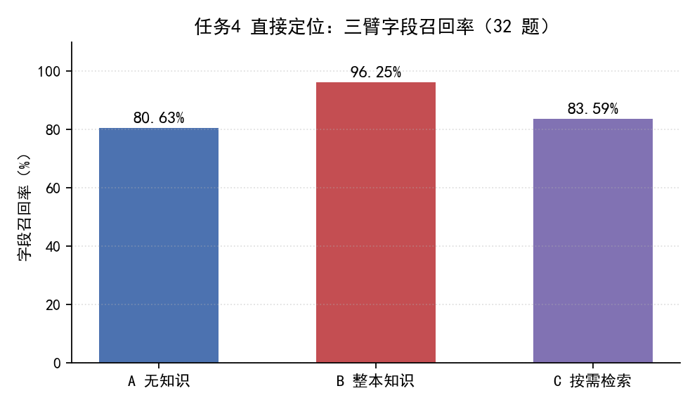
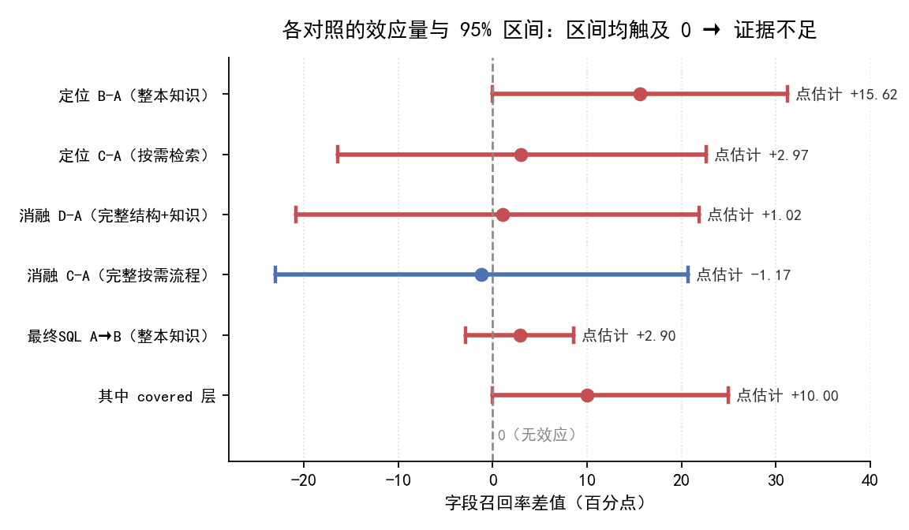
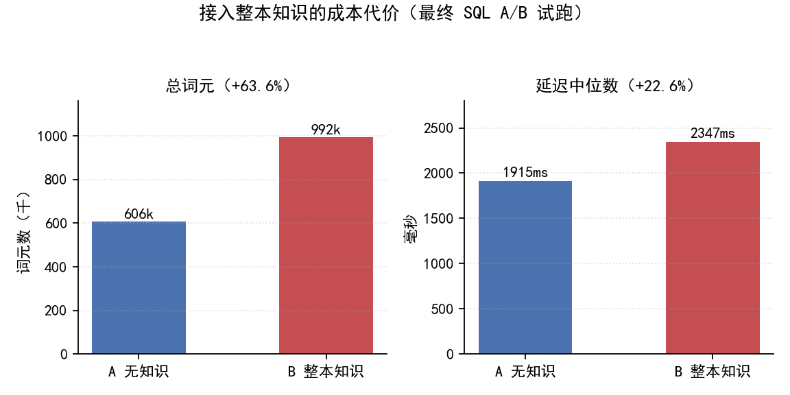

# Ontology 接入项目分析报告

**版本**：v0.1　**日期**：2026-10-04　**范围**：AdventureWorks 任务 4（多表 SQL 问答中的 schema 定位）与最终 SQL 生成

---

## 一、分析对象与范围

本报告回答一个问题：**把 EvoOntology 论文提出的"本体（ontology）知识层"接入本项目，能否给项目带来可验证的收益。本次评估选取项目的中级任务 4「精准表定位」作为一项代表性验证场景。**

先区分两个不能混淆的对象：

| 对象 | 是什么 | 性质 |
|---|---|---|
| **① 本次选取的验证场景：项目任务 4** | 自研 `app/nl2sql/linker.py`：向量召回候选表/字段 + 外键图剪枝 | **必交付**，占中级任务 5 分（初赛三项 1+4+7 即满 15 分） |
| **② EvoOntology 知识层** | 论文做法：把"概念→字段 / 连接路径"等业务知识整理成一层，注入提示词或按需查询 | **可选增强**，非评分项 |

**本报告只判定"对象 ② 能否增强对象 ①"，不评价论文在其它任务或数据集上的价值。**

---

## 二、参照方法要点（客观陈述）

论文把"本体"建成三层，并支持自演化：

| 层 | 内容 |
|---|---|
| Content | 业务概念、别名、概念→字段/连接路径映射、字段可用性约束、来源证据 |
| Schema | 上述各类节点的字段定义与引用规则（相当于本体自身的"表结构"） |
| Tool | 把本体封装成可查询接口（browse / resolve），只有极简清单进提示词，明细按需取 |
| 自演化 | 从运行轨迹找失败 → 归因到某一层 → 单层修改 → 配对评估通过才接受 |

**关键事实**：论文自身的增益主要来自 **Tool 层 + 自演化**（Tool 层编辑占累计增益约 57%）；而"把知识整体塞进提示词"（Content 静态注入）是论文自己标注为**较弱**的用法。本项目这轮验证的正是**后者**。

---

## 三、验证方法

共四组对照实验，均在同一冻结环境、同一模型（`deepseek-v4.1-flash`，温度 0）下运行，统计单位为"题"：

| 实验 | 规模 | 比较 |
|---|---|---|
| 任务4 直接定位 v0.2 | 32 题 | A 无知识 / B 整本知识 / C 按需检索 |
| 任务4 四臂消融 v0.3 | 32 题 | A / C / D（完整结构+知识）/ E（结构+无知识） |
| Builder 独立验证 v0.1 | 新查询 30 题 | A / B / C |
| 最终 SQL A/B 试跑 v0.2 | 35 题 × 2 轮 | A 无知识 / B 整本知识 |

**方法可信度控制**：题目与 Gold 经独立盲审（盲审者不看知识包、模型输出与数据库校验结果）；冻结清单含模型名、脱敏服务地址、温度、令牌上限、超时与软件版本，并以 SHA-256 快照；评分器经 12/12 校准；失败与无效输出一律按零分保留，不剔题；模型重复请求在题内先取平均，**不当作额外独立样本**。

---

## 四、实验数据与结果

### 4.1 任务 4 直接定位（32 题）

| 组别 | 字段召回率 | 表召回率 | 平均词元/题 | 中位耗时 |
|---|---:|---:|---:|---:|
| A 无知识 | 80.63% | 81.25% | 10,113 | 6.36 秒 |
| B 整本知识 | 96.25% | 96.88% | 16,099 | 6.66 秒 |
| C 按需检索 | 83.59% | 84.38% | 4,326 | 9.04 秒 |

### 4.2 各对照的效应量与 95% 置信区间

> 说明：**95% 置信区间**指——重复做同类实验时，真实的效应量有 95% 的概率落在这个范围内。若区间**包含 0**，就意味着"真实效果有可能是 0（毫无增益）"，此时不能判定有效。

| 对照（右 − 左） | 效应量（百分点） | 95% 区间 | 区间是否含 0 |
|---|---:|---|---|
| 定位 B − A（整本知识） | +15.62 | 0 至 +31.25 | **含 0** |
| 定位 C − A（按需检索） | +2.97 | −16.41 至 +22.66 | **含 0** |
| 消融 D − A（完整结构+知识） | +1.02 | −20.86 至 +21.88 | **含 0** |
| 消融 C − A（完整按需流程） | −1.17 | −23.05 至 +20.70 | **含 0** |
| 最终 SQL A → B（整本知识） | +2.90 | −2.90 至 +8.60 | **含 0** |
| 其中 **covered 层**（知识覆盖题） | +10.00 | 0 至 +25.00 | **含 0**（且仅 10 题） |

**全部六个对照的区间都触及或包含 0。** 唯一方向性正向信号是"知识覆盖题"（covered 层）的 +10 个百分点，但只有 10 道题、区间下界恰为 0，**不足以宣称稳定收益**。

### 4.3 最终 SQL 正确率与成本代价（35 题 × 2 轮）

| 指标 | A 无知识 | B 整本知识 | 差异 |
|---|---:|---:|---|
| 最终 SQL 正确 | 61/70（87.1%） | 63/70（90.0%） | +2.9 个百分点（区间含 0） |
| 输出列契约通过 | 70/70 | 70/70 | 0 |
| 总词元 | 606,570 | 992,197 | **+63.6%** |
| 延迟中位数 | 1,915 ms | 2,347 ms | **+22.6%** |
| 请求失败 / 长度截断 | 0 / 0 | 0 / 0 | — |

**读法**：加入整本知识后，正确率只升 2.9 个百分点且区间含 0（不排除"其实是 0"）；同时成本**确定地**上升——词元 +63.6%、延迟 +22.6%。

---

## 五、结论

1. **证据不足 → 暂不接入主链路。** 在现有实验条件下，未观察到"整本知识"或"按需检索"对本项目任务 4 定位/最终 SQL 的**稳定**收益；各对照的 95% 区间均触及 0。
2. **这是"证据不足"的工程决策，不是"已证明无效"。** 两级含义不同：本实验**没有能力**判定真实效应是否为零，因此不能下"无用"的结论。
3. **唯一正向信号**：知识覆盖题（covered 层）+10 个百分点——方向与论文机制一致，但样本仅 10 题，需扩大样本才能确认。
4. **成本确定上升**：整本知识令词元 +63.6%、延迟 +22.6%。为"尚未证明的收益"支付确定成本，不划算。

---

## 六、可信度与边界

**可信的方面**：冻结快照（SHA-256）、独立盲审、Gold 独立审计、评分器 12/12 校准、0 请求失败 / 0 截断、失败保留不剔题、重复请求不冒充独立样本。

**必须说明的边界（避免过度解读）**：
- 题集为**人工构造**的 32/35 题基准，**不代表真实用户问题分布或赛题评分**；
- **单一模型**、**单库**，且模型端点未公开权重修订号，结论仅限于记录的端点与日期；
- 每臂**单轮或 2 轮**，估计区间很宽；
- 本实验测的是**论文自认较弱的 Content 静态注入**；论文真正的强项 **Tool 层 + 自演化**（约 57% 增益来源）**未在本轮验证**，故本结论**与论文并不冲突**。

---

## 七、决策与建议

1. **主链路不接入**：不加入默认的整包知识提示，也不接入完整的按需检索流程。**任务 4 照常走自研 `linker.py`（向量召回 + 外键图剪枝），这才是拿分路径。**
2. **保留为研究资产**：现有知识包与全部实验结果留存，作为可追溯的研究记录。
3. **可借鉴项（零成本）**：
   - **溯源纪律**——"每条知识带来源 + 回库校验"与本项目 `Ref`/`TraceStep` 同构，可强化可解释性表述；
   - **字段可用性事实**——如"金额类字段为空、须用表达式计算"一类结论，可沉淀为 `infra/schema_meta` 的增强注释，对任务 1（别名归一化）与任务 4（字段定位）有潜在参考价值。
4. **重启评估的触发条件**：待项目积累真实、独立、有代表性的问数题集后，若"知识覆盖题"的增益在新题上得到区间支持（下界 > 0），再提接入提案。

---

*数据来源：`eval/experiments/evont_next/run_task4_v0.2`、`run_task4_v0.3d_ablation`、`run_task4_ab_pilot_v02` 及其对应报告；图表由 `agent_temp/make_ontology_report_figs.py` 依据上述冻结产物生成。*
