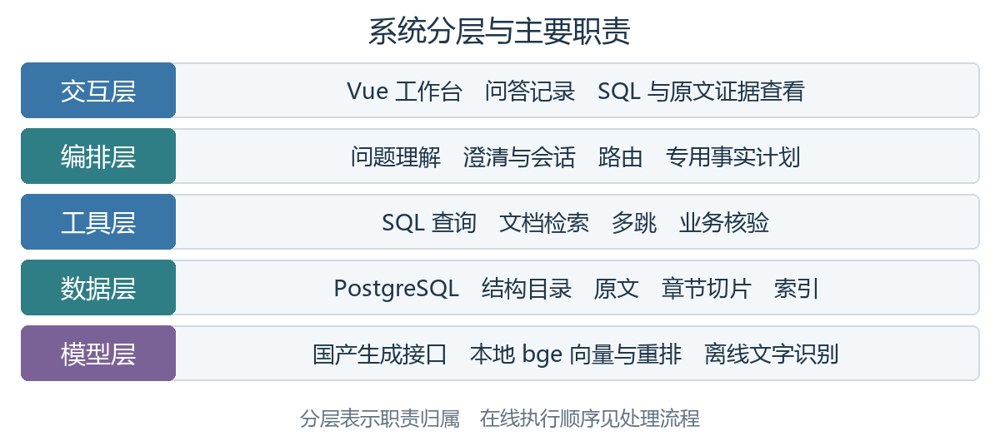
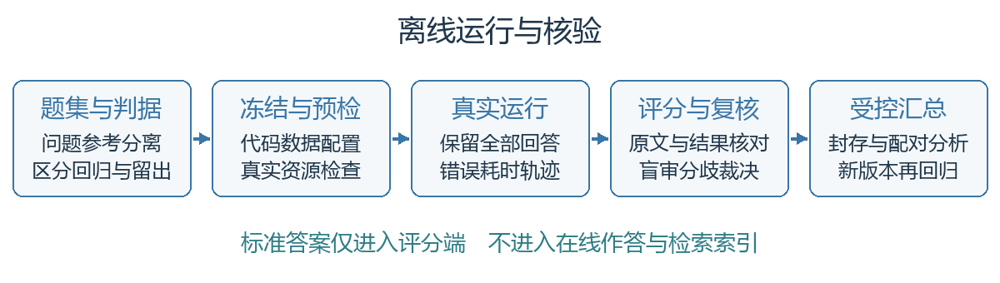

# 1 总体架构与接口设计

## 1.1 系统职责与运行范围

本说明书描述数据库问数、文档问答、跨源事实核验及来源展示的实现。在线生成由国产语言模型接口支持，本地 bge 模型承担文档向量化与重排，离线文字识别用于扫描 PDF。系统以单智能体和工具调用组织运行，统一数据结构记录实际工具产出与来源。[1][2]

产品名称为知证 VeriMind。系统组成仍按交互、编排、工具、数据和模型五层描述；跨源复合问题的核验机制称为事实—证据核验架构（FEVA）。项目展示名称及代码映射见 `docs/品牌与技术命名_v0.1.md`。



图 1 系统分层与主要模块

用户输入先结合会话上下文进行标准化与语义检查，再由编排层选择工具。普通问数和文档问答走对应短路径；当前跨源事实计划通过开关显式启用，覆盖工单与合同判定场景。深度检索已接入为可选扩展路径（Beta）：默认走标准检索；项目侧已实现检索模式字段与候选回切校验，KAG 服务未就绪时界面禁用深度检索选项；纯数据库问数不调用 KAG。[9]

数据准备与作答分开。数据库结构目录、业务别名和关系信息为查询提供约束；文档解析输出章节切片、原文定位和检索索引。编排层复用这些资源并合并工具记录，既记录成功步骤，也记录失败与未执行步骤。

## 1.2 模块输入与返回结构

公共数据结构由 app/contracts.py 定义。请求包含 question 和 session_id。统一工具结果包含 data、trace 和 refs；响应还包含 sql、need_clarify、result_set 和 suggestions 等实际字段。引用使用区分结构化来源与文档来源的联合类型，避免转换过程丢失定位字段。

| 对象 | 主要字段 | 职责 |
|---|---|---|
| AskRequest | question session_id | 输入问题与会话标识 |
| ToolResult | data trace refs | 工具产出及来源交接 |
| TraceStep | step_id tool input output elapsed_ms hit | 实际步骤记录 |
| SqlRef | table column row_pk snippet | 结构化来源定位 |
| DocRef | doc_id page section_path char_start char_end bboxes | 文档与可得定位 |
| AskResponse | answer sql refs trace need_clarify result_set suggestions | 面向前端的响应 |

表 1 公共数据结构与字段职责

执行轨迹（Trace）记录代码实际执行的工具名称、入参、出参、耗时和来源。模型生成的思考叙述不替代这些记录。最终引用与检索候选不同；跨源事实机制另维护内部证据账本，明确区分候选、已选引用和已核验事实。

## 1.3 问答接口与结果访问

主要问答入口为 POST /api/ask。健康检查 GET /health 用于基础连通性检查，不能代替模型、数据库和文档问答的实际请求。大结果集的分页和导出通过独立接口取得，要求提供与原查询对应的会话标识。

| 接口 | 方法 | 用途与约束 |
|---|---|---|
| /api/ask | POST | 提问与继续澄清 |
| /health | GET | 服务基础健康状态 |
| /api/results/{result_id} | GET | 查看短期缓存结果页 会话绑定 |
| /api/results/{result_id}/export.csv | GET | 仅完整结果可导出 |
| /api/documents/{doc_id}/file | GET | 返回语料目录中的实际 PDF |

表 2 问答入口与结果访问接口

文档接口按实际文件标识匹配来源，避免任意路径访问。结果标识具有随机性和过期时间，但会话标识不等同于完整身份认证；当前实现范围不能描述为已完成企业级权限认证。

## 1.4 配置与后端选择

模型名称、服务地址、语料、数据库结构目录以及检索后端通过配置选择。普通文档单轮与多跳分别使用 rag 和 rag_multihop 后端。模型与数据库凭据由部署环境注入，不写入报告、源码或测试截图。

跨源事实计划需要显式启用隔离入口及事实计划执行器，读取独立结构目录、文档目录和数据库连接。该配置边界使专用实验能够与普通主线区分。最终候选的模型、软件版本、配置摘要和数据指纹在以下表格补齐。

| 最终运行信息 | 填写值 |
|---|---|
| 完整代码提交号 | `f0246ab`，2026-10-18 交付包快照；正式提交号在提交日以标签锁定，本节随包重建 |
| Python 与 Node 版本 | Python 3.11.16（项目虚拟环境）；Node.js 24.18.0（仅重建前端时需要） |
| 国产生成模型与服务标识 | GLM-4-Flash（智谱开放平台，OpenAI 兼容接口）为当前生效档；另注册 DeepSeek-V4.1-Flash（火山方舟）为可切换档。两档密钥均由部署环境注入，不写入报告与源码 |
| bge 嵌入与重排模型版本 | 嵌入 BAAI/bge-m3、重排 BAAI/bge-reranker-v2-m3；权重不随源码包分发，缓存在 `models/`，首次运行按需下载 |
| PostgreSQL 与 pgvector 版本 | PostgreSQL 16.15（Debian 16.15-1.pgdg12+2）；pgvector 0.8.6 |
| 普通问答和跨源开关配置摘要 | `RETRIEVE_TOP_K=20`、`RERANK_TOP_K=5`、`SQL_READONLY_ONLY=true`、`SQL_AUTO_LIMIT=1000`、`DOC_SEARCH_BACKEND=rag`；跨源须显式启用隔离入口与事实计划执行器，默认关闭 |

表 3 最终运行信息登记

上表按 2026-10-18 的实际运行环境取值，不是范围依赖或历史版本推算：版本取自运行中的容器与虚拟环境，配置项取自 `.env` 实际键值，模型档位取自 `app/model_profiles.py` 的注册表与生效配置。仍待提交日补记的是正式提交标签与两份文档的审核日期，见 8.2 表 20 与设计报告第 7 章交付信息表。

# 2 自然语言转 SQL 实现

## 2.1 输入标准化与要素记录

app/nl2sql/normalizer.py 处理业务别名、错别字、全角字符、中英文混排、口语冗余和相对时间。输入输出保留原始问题、规范化问题、识别要素、改写记录以及未解决内容；改写依据可进入执行轨迹，便于判断系统是否保留用户原意。

这条结构化查询链路在项目展示中称为查询卫士（QueryGuard）。

识别优先使用元数据派生词表和人工维护的业务别名。模块为语义兜底预留可注入接口，但其生效依赖运行时配置，不能仅依据接口存在宣称默认开启。无法可靠消解的内容保持不确定状态，交由澄清处理。

相对时间以配置的时间锚点进行解释。可复现测试必须记录时间锚点，避免同一句“去年”在不同日期产生不可比较的 SQL。新增业务需要更新结构目录与业务描述，并对新增别名进行核查；系统不声称实现无人工成本的任意领域泛化。

## 2.2 语义澄清与会话恢复

app/clarifier.py 对显著缺失必要条件的查询进行确定性检查。增长率等问题需要明确指标、基期和比较范围，缺少必要维度时先发起澄清。规则覆盖范围有限，明确问题也需要测试是否出现多余追问。

app/memory.py 按会话标识保存待澄清状态和最近查询上下文。用户补充条件后恢复原始问题并合并已确认信息；取消或新问题替换待处理任务，避免新旧问题条件混入。交错会话需分别测试，防止状态串用。

当前状态位于单进程内存。过期或服务重启后用户需重新提供条件，不支持跨多进程共享状态。浏览器保存的会话历史是呈现记录，不能被描述成等价的服务端长期记忆。

## 2.3 表字段定位

模式链接（Schema Linking）用于把用户要素对应到数据库表和字段。app/nl2sql/linker.py 综合对象、指标、结构目录、中文业务描述和别名对候选排序，并利用外键闭包补充所需关联表。当前主要定位机制是元数据与规则评分，语义评分可注入；不能把它写成默认全量向量检索。

定位输出保存候选分数及依据。显式字段、取值和业务语义帮助区分名称相近的表，候选相似只说明应进一步检查，不能建立关联关系。定位还需要测试目标表进入候选后的 SQL 是否真正采用正确字段和路径。

AdventureWorks 用于数十张表的干扰环境。结构目录中的表数与实际数据库基表、视图统计可能采用不同口径，因此报告须明确统计范围并填写实际快照，不将历史的某个表数作为所有环境统一事实。

## 2.4 外键路径与查询粒度

app/nl2sql/join_planner.py 依据结构目录声明的外键生成关联计划。对目标表之间的受限路径搜索设置深度与候选路径数量上限；多条同长路径可能意味着业务歧义，不能只因某条路径最短就视为已证明业务适用。

计划记录表、关联键、候选路径、目标粒度和告警。同名字段不直接形成外键。复合键需要完整列组，不以部分列匹配假定唯一关系。SQL 生成时使用关系计划，语义校验再次检查实际关联是否与计划一致。

多表聚合关注重复计数与指标粒度。例如订单头金额与订单明细连接后可能被重复累加，单纯语法正确不足以通过。app/nl2sql/semantic_validator.py 对可识别的关联条件及明显粒度风险进行检查；未覆盖的复杂语义仍依赖结果对照和专项测试。

## 2.5 候选 SQL 生成与校验

app/nl2sql/pipeline.py 串联定位、规划、生成、校验和执行。生成模型收到用户问题、相关结构与计划约束，返回候选 SQL；实际执行前由 app/nl2sql/validator.py 使用 sqlglot 解析抽象语法树，检查只读性质、可用表字段及受支持结构。

业务执行路径禁止 INSERT、UPDATE、DELETE、DROP、ALTER 等写操作。只读判定不仅依靠关键词，而依靠语法结构；同时数据库执行器使用只读事务形成第二层保护。索引准备及数据导入的写入属于离线管理流程，与用户问答的业务 SQL 路径分别控制。

校验器也处理结果限制和方言相关约束。使用 sqlglot 有利于预留方言处理接口，但不能据此宣称已完成达梦、人大金仓等数据库适配；换库还涉及驱动、类型、语法和来源定位测试。

## 2.6 有限修复与执行异常

一次生成视为一次尝试，生成、静态校验与数据库执行在同一个受限循环中记录。语法、字段、类型和部分聚合错误可能因回传明确错误而得到修复；超时、连接和权限问题不能通过反复改写 SQL 解决。

执行重试依据数据库错误类别决定，权限不足明确排除。模型客户端的网络重试与 SQL 修复是不同预算，需要分别记录；不能把工具步骤数等同于服务商请求数或费用。最终候选的实际次数与时限由配置和运行记录核对。

| 失败类型 | 处理方式 | 保留证据 |
|---|---|---|
| 语法或表字段错误 | 有限回传重新生成 | 原 SQL 校验错误及后续尝试 |
| 可修复的执行语义错误 | 按 SQLSTATE 分类修复 | 数据库错误与执行步骤 |
| 权限不足或连接故障 | 返回明确失败 | 错误类别 不伪造零结果 |
| 语句超时 | 终止当前执行并说明 | 时限与实际执行状态 |
| 结果超过容量 | 标记截断 | 已取得范围与限制 |

表 4 执行失败分类与保留证据

## 2.7 只读执行与大结果管理

app/nl2sql/executor.py 连接 PostgreSQL 并配置只读事务、语句时限及读取容量。结果按列和行组织，空结果保留列信息，失败则保留错误。零行与执行失败必须区分，不能用连接失败证明记录不存在。

app/result_sets.py 在进程内维护有行数、字节、条目数及过期限制的短期缓存。结果标识随机生成并绑定会话，分页顺序保持一致。仅 complete 为真的结果允许完整导出；截断、过期和会话不匹配由接口明确拒绝。[4]

历史开发回归中已记录 U19 完整分页与导出检查，但最终交付候选仍需按同版代码、数据快照和接口复验。正式报告中的结果总行数及测试结论从最终记录填写，不回用早期截断或其他代码版本的结果。

# 3 文档检索问答实现

## 3.1 多格式解析与扫描页文字识别

本项目的问答对象是多模态数据：不是单一文本，而是三类形态并存——公告与合同的扫描件是位图；条文、设备清单与中标明细是带行列关系的表格；其余是带版面与层级的文本。三类形态在这里走同一条链路——图像经离线识别转成文字，识别结果是位图像素坐标，按页面原始尺寸逐轴折算为 point 后回指原文框；表格抽取后保留行与字段关系，结构无法确认时宁可留空也不强行重组；文本按章节编号与字号线索识别层级后切片。三条线的产物最终落到同一份引用结构（文档、页码、章节路径、字符区间、可得框坐标），因此无论证据来自哪一类形态，回答里都能回到当初看到它的那一页。下文按这条链路依次说明。

app/rag/ingest/loader.py 支持 PDF、DOCX、Markdown 和 TXT。PDF 文本层由 PyMuPDF 提取，保留页码、字号、文本块和版面信息；扫描页按页进入离线文字识别。混合 PDF 可以在不同页采用不同抽取方式，不把整份文档只归为一种来源。

这条文档解析与检索链路在项目展示中称为文证透镜（DocLens）。

扫描页识别用离线的 `rapidocr_onnxruntime`（RapidOCR 的 ONNX 运行时版，权重随 wheel 内置，不联网下载模型）。触发条件是页级判据而非文档级：整页文本层字符数少于 `OCR_MIN_TEXT_CHARS`（默认 20）就整页转识别，混合 PDF 里同份文档可以部分页走文本层、部分页走识别。渲染 DPI 默认 150（`OCR_RENDER_DPI`）：实测 100 DPI 单页快约 25%（6.9 秒对 8.7 秒/页），但 KB-007 会少识别一行，本项目的评测要点是编号与数字，故取 150。单页识别实测 7 至 10 秒，百页扫描件全量要 700 秒以上，因此按「文件内容摘要 + 页号 + DPI」做页级缓存（`OCR_CACHE_DIR`），文件一改即失效。引擎按需加载，缺依赖时能力探测为假、链路照常运行（扫描页仍无切片），由语料清单点名报出，不在导入期抛异常。识别结果是位图像素坐标，写回前须按「页面原始尺寸 ÷ 位图尺寸」逐轴折算为 point：595/1240 与 842/1755 两个方向并不相等，少乘这一步会把高亮框放大约 2.08 倍。识别给不出可靠字号，故按 0 记字号，使字号线索在目录识别中自然失效，扫描件章节只靠编号判定。

纯文本缺少真实版面坐标，不能把用于行顺序处理的信息冒充像素位置。来源定位因此保留可得字段，无法获得真实框坐标时为空。扫描件既要检查正文是否抽出，也要对原图核对关键数字、标题与条款，块数不代表识别准确率。

## 3.2 文本规范化与表格还原

app/rag/ingest/normalize.py 处理页内硬断行和可识别表格行，使术语、数值和表头更适合检索。对于真实表格，抽取后保留行与字段关系；无法确定结构时不强行重组，避免把相邻数字串错到其他指标。

规范化保留原文来源映射，正文引用仍需可回到真实页码和片段。当前页内断行处理不等同于已解决全部跨页表格和跨页断行问题，复杂文档需要额外检查，不能把局部样例成功写成格式全覆盖。

## 3.3 目录识别与层级切片

app/rag/ingest/toc.py 优先读取内嵌目录；缺少目录时利用标题编号，再使用字号线索识别层级。app/rag/ingest/chunker.py 把正文组织到相应章节，记录文档、页码、章节路径、字符区间和可得框坐标。任务 7 的验收重点是这些结构关系，而不是程序退出码或最后答案是否碰巧正确。

目录混乱可同时包含标题顺序变化、正文条款错置和层级丢失，不能简单按物理相邻位置推断语义归属。B 在指定旧 RAG 版本曾发现 KB-015 的 5.2 条款被归到“1 人员出入管理”、KB-008 扫描件的章节数为零；这两项已在当前工作区复测，条款章节路径已正确，中文序号标题可进入目录识别。复测属开发回归，不等同于未见文档的泛化证据。[7][8]

## 3.4 向量与关键词资源准备

app/rag/retrieval/indexer.py 使用本地 bge-m3 生成稠密向量，当前维度为 1024。pgvector 存储同时保存片段正文及来源字段，供其他进程重建候选与引用；本地开发的内存后端与真实 PostgreSQL 后端应在记录中区别。

BM25 在准备阶段统计词频、文档频率和长度信息，检索阶段按当前切片集合评分。当前实现是内存扫描型关键词召回，不能写成已部署的分布式倒排搜索引擎。索引构建的创建与写入和在线只读问答是两个流程，不共用“所有操作都只读”的描述。

模型文件在本机准备后用于离线推理。预检检查模型配置与语料等基础资源；健康检查成功不代表权重已加载或实际检索可完成。模型体积较大，交付需要明确权重取得方式、配置和初始化时间。

## 3.5 双通道召回与重排

关键词通道适合合同编号、设备编号与明确术语，向量通道补充语义近似表达。app/rag/retrieval/fusion.py 使用排名融合（RRF）整合通道排名，避免把不同量纲的分数直接相加。同一原文片段按来源定位去重。

融合候选由本地 bge 重排模型再次排序，然后截取生成上下文。检索数量、重排后数量和实际送入模型的片段需分别记录；不能把文档命中、答案正确和引用完整当作同一个指标。通道可以返回语义相近但业务不适用的片段，因此仍需检查问题对象和条款条件。

## 3.6 多跳检索与证据链

app/rag/multihop.py 对需要跨片段或跨文档的问题生成子问题或依赖步骤。前一步检索得到的实体和事实作为后一步查询线索，合并去重后进行跨轮重排，最终汇合上下文并生成一次答案。跳数和子查询数量设置上限，避免无界检索。

普通单轮与多跳由配置选择，不能描述为所有问题都经过自动多跳。充分性检查影响是否继续检索，但其判断仍有失败可能，需要在测试中检查漏检、错误中间绑定和过度补查。多跳中间实体不能来自参考答案或脱离原文的猜测。

多跳引用需要覆盖必要事实链，并保护关键来源不被最终截断全部丢弃。引用补全只能采用实际取得的来源；来源间的制度关系或适用规则仍须由原文明确支持，不能由两个片段相似推出关系。

## 3.7 约束生成与引用

app/rag/answer.py 将检索上下文交给语言模型，要求仅据材料回答并使用编号引用。返回后解析引用标记，整理最终引用及原文定位。文档解析过程的信息可投影进轨迹，说明来源由文本层或文字识别取得。

引用坐标与文本定位用途不同。字符区间用于片段定位和去重，bboxes 及真实页面尺寸用于几何高亮。缺少框坐标时前端展示文本和页码，不绘制虚假框。生成提示和引用解析属于约束与可审查机制，不能被描述为已自动证明每个自然语言事实均正确。

# 4 多源融合与事实核验实现

## 4.1 机制与当前场景

事实—证据核验架构（FEVA）描述多源融合的处理机制：先定义待回答事实及依赖，再根据事实选择数据源，确认对象对应、业务口径和适用范围，最后形成有来源支持的结论。当前 app/fact_planner.py 构造工单—合同的显式事实计划，app/fact_executor.py 按依赖执行，app/cross_source_fact_plan.py 绑定真实 SQL 与文档工具。


图 2 当前专用事实计划的执行顺序

节点包括工单事实、受控合同映射、事件耗时、合同条款及结论。必要时添加首次响应的并列事实。当前原型以修复完成及其与首次响应的组合判定为主要范围，不声称已实现全部指标的任意组合规划。

扩展到问数、文档问答与跨源三类问题的统一核验属于已认可方向：三条路径共用“明确事实、执行取证、按适用规则检查、登记状态及证据、组织回答”的编排主干与证据记录格式，差别在取数工具与关系判定。该扩展到本版为止处于实现中，尚未取得运行证据；未取得运行证据的部分以交付候选版本的实测记录为准。[13]

## 4.2 事实计划与前置依赖

事实流（FactFlow）对应事实计划与依赖执行。FactPlan 保存任务与依赖，执行前校验依赖是否存在和是否成环，再给出可执行顺序。计划中，一个时限判断不仅依赖合同条款，还依赖已核验的对象关系及事件间隔；后续任务必须等待必要前置事实得到支持。

执行器为未配置处理器、执行异常和前置不足记录未执行或失败原因。它不把“未执行”写成“查无记录”，也不将前置未支持的派生结果提升为已证实。在实验消融路径允许继续调用下游工具时，账本仍保留候选性质。

任务依赖图自身是无环结构，但在线澄清、检索重试和补查可以存在回路。两者在图示和报告中区分，避免把完整运行过程错误描述为永远无环。

## 4.3 对象对应与受控映射

跨源证桥（SourceBridge）负责检查结构化记录与文档所指对象是否对应。结构化工具取得工单的设备标识、开单时间和设备客户；合同映射记录提供合同标识、映射依据及有效区间。名称相同只产生候选，受控映射依据和稳定业务编号才用于桥接。映射策略从独立政策文件读取，不能仅靠模型解释把未受控依据变成有效绑定。

映射有效期与合同有效期分别覆盖业务日期，合同状态和客户范围另行检查。存在多份同时有效且无法唯一确定的合同、映射悬空或客户冲突时，记录阻断依据并限定结论。多个候选不直接取第一条，零结果来源于实际查询。

## 4.4 事件与口径对齐

口径对齐（MetricAlign）负责在比较前核对事件与合同定义。修复耗时以 accepted 至 service_restored 的实际事件间隔计算，检查关键事件是否存在、时间顺序是否成立，并统一时区。首次响应是独立指标，不把响应时限或到场时限当作恢复时限。等于阈值是否满足按已登记的业务判据执行并单列边界测试。

文档核验同时检查适用设备范围、条款阈值、特别约定、明确未约定与冲突。多个时限不能在没有适用依据时择优选取。当前文档解析依赖受支持的表达形态，自然业务文档的同义表达及复杂表格仍需补充验证，不能以受控形态测试推断全部合同均可解析。

## 4.5 证据账本与来源关联

证据账本（EvidenceLedger）由 app/evidence_ledger.py 实现，保存事实值、状态及证据标识，状态区分 candidate、supported、contradicted、insufficient 和 ambiguous。检索命中和最终引用不会自动将事实标为 supported，处理器需要显式给出核验结果。

决定性证据必须来自本轮工具或已登记的前置来源。若处理器给出 supported 却没有可登记来源，执行器将其降为证据不足。最终事实引用和阻断证据投影到统一响应，用户能够复核判断依据。

| 事实状态 | 含义 | 回答处理 |
|---|---|---|
| candidate | 来源候选 尚未证明适用 | 不直接作为确定结论 |
| supported | 当前范围内有明确证据支持 | 可用于依赖与回答 |
| contradicted | 存在相反依据 | 说明冲突或不成立 |
| insufficient | 缺少必要证据 | 限定回答或停止依赖任务 |
| ambiguous | 候选或规则不能唯一确定 | 保留歧义 请求必要补充 |

表 5 事实状态、含义与回答处理

## 4.6 负面事实与有界处理

有界求证（BoundedVerify）管理补查和依赖失败。记录不存在需要真实执行依据。零行查询证据由查询表、过滤条件和实际行数构成，不能采信模型自行声称“没有记录”。执行失败、未查询和实际零行是不同状态，评测中分别核对。

早停原因按具体协议与策略管理。依赖不成立时跳过后续任务，保留已确认事实；检索未取得必需条款时进行受限处理。明确未约定、材料冲突和召回失败有不同业务含义，拒答正确与否必须依原文事实判断。

CS18 的两道多合同题已记录判断形成后仍检索文档的晚停情况，因此本说明书不把“所有多合同歧义都检索前停止”写成已验证不变量。包级合同状态原因与通用协议原因码的优先级尚有开放项，需书面裁定后在新版本统一，不回写已冻结历史协议。[3]

## 4.7 KAG 增强接口边界

KAG 增强路线（原代号 Gap2Graph）是已接入的可选深度检索增强路径，默认关闭；标准路径仍使用项目自身检索。它用于在关系或证据存在缺口时补充候选，并要求候选能够回到原始文档证据。项目侧接入代码与前端入口已实现：请求携带检索模式，标准问答行为不变；用户选择深度检索时先执行项目自身检索，再把 KAG 返回的候选原文按文档集合、原始文件哈希、规范文本哈希与原文坐标逐项回切校验，与自身候选一起重排。最终答案与引用仍由项目生成，KAG 不生成面向用户的最终业务答案，纯数据库问数不调用 KAG；服务不可用、索引未就绪、超时或候选无法映射回原文时记录失败状态并回退。当前运行环境未就绪，因此界面禁用深度检索选项；代码接入不等于真实检索已达到启用门槛。[9]

自动化检查不能替代召回质量。项目侧的定向测试证明接口与候选融合逻辑按契约工作，不证明 KAG 在业务题上的召回质量。烟测语料为 15 份文档、16 个页面索引单元与 103 个项目切片；8 条原始候选经序列化解包后仅 5 条映射回来源，问题同时要求的另一份文档未出现，候选预算翻倍后仍未出现，且同一问题跨两次调用结果不一致；单次调用耗时约 24 至 138 秒，样本很少，不构成性能分布。真实检索的稳定性、召回质量、构建身份与交互耗时均未通过启用门槛。[9]

| KAG 扩展路径记录 | 填写值 |
|---|---|
| 独立实验报告版本与证据位置 | 接入实现与验证记录 v0.2（2026-10-15），见 `docs/architecture/KAG深度检索接入实现与验证记录_v0.2_20261015.md`；烟测原始产物在临时目录，不随源码包分发 [9] |
| 真实资料来源与独立问题数量 | 真实资料为 15 份业务文档构成 16 个页面索引单元、103 个项目切片；独立问题 1 道（同一问题跨两次调用观测），另加项目侧定向测试 78 项 [9] |
| 参考流程与补充流程判据 | 候选须按文档集合、原始文件哈希、规范文本哈希与原文坐标逐项回切校验；映射失败的候选不进入重排，也不生成面向用户的答案。参考流程与补充流程同题对照，判据为映射是否成立与必需文档是否出现 [9] |
| 答案 引用链 失败与耗时结果 | 8 条原始候选经序列化解包后 5 条映射回来源；单次调用 24 至 138 秒，样本少 [9] |
| 主项目接入与复验结论 | 项目侧接入代码、前端入口与失败回退已实现；当前运行环境未就绪，深度检索默认关闭且界面禁用 [9] |

表 6 KAG 扩展路径记录登记

上表只有后三行有可复核结果，前三行按 2026-10-15 的 v0.2 记录登记，并保留两处否定结论：另需的一份文档在候选预算翻倍后仍未出现，同一问题跨两次调用结果不一致。因此 KAG 仍记作默认关闭的可选扩展路径，不接入标准问答。

# 5 可解释性与可靠性实现

本章对应可解释性实现方案的三个要求：推理链路追踪、数据来源标注与工具调用链可视化，并说明配套的安全与异常处理。三者的共同前提是记录真实发生的事实——工具名称、入参与出参、耗时、实际命中位置与失败原因均来自代码执行记录，不由模型叙述生成。

## 5.1 工具记录与答案来源

工具记录与最终引用使用公共结构交接。每一步保留工具名、参数、返回摘要、耗时和实际命中。SQL 路径可看到生成、校验和执行过程；文档路径可看到召回、重排、生成和引用；跨源路径另显示事实核验与未执行原因。

解释记录只说明实际发生的事。没有执行的数据库查询不能生成命中证据；未取得的文档不能由模型补出来源；聚合结果不能为满足字段要求而伪造单行主键。引用字段拿不到时留空，并记录能够支持复核的查询或来源范围。

证据账本按请求隔离。追问可以继承问题条件与查询状态，但不能把历史证据当作本轮证据；对象、时间或口径变化后，需重新取得受影响的事实及下游结论。账本本身刻意置于编排层内部、不进入公共契约，对外只提供按响应版本协商的只读投影：投影逐条给出事实标识、标签、摘要、事实状态、执行状态、证据关联状态与检查记录，并持久化本轮的引用序号。投影不是逐句答案核验；检索命中、被引用与事实已验证是三种不同状态，前两者都不会自动升级为第三者。未接入事实级检查器的单源路径只标注为来源执行记录，缺关系检查的跨源路径标注为关系未核验。[2][5]

## 5.2 前端呈现与坐标

工作台消费实际响应字段，答案中的引用编号与来源卡片支持打开证据面板。文档渲染使用实际 PDF、页码和可得框坐标，坐标换算依页面范围。非 PDF 或无框坐标的来源仅提供文本与章节定位，不声称像素级高亮。[5]

执行过程面板展示结构化工具步骤而非模型思维链。数据库大结果通过分页接口读取，导出先检查完整性。前端等待上限与服务端任务执行不是同一个控制：停止等待可以恢复浏览器输入，但服务端可能仍在处理，不能描述为已实现可靠的全链路取消。[5]

事实处理与证据记录卡片消费上述投影：事实级检查器已接入的路径显示事实目标、真实检查状态与证据引用；未接入事实级检查器的单源路径标注为来源执行记录并明确未作事实级判定；缺少关系检查器的跨源路径标注为关系未核验，不把引用存在或执行成功显示成严格通过。该卡片仅在后端返回协商成功的投影时出现，旧版本响应与未协商请求保持原有呈现。左侧连通状态只检查服务健康接口，不代表模型、数据库与知识库均已实际连通；界面另有错误、超时、无结果与需补充条件的独立呈现，结果集过大时分页展示并可导出。[5]

## 5.3 安全与异常分类

SQL 语法结构校验与只读事务共同防止业务路径写入；表字段和外键关系受结构目录约束。外部服务配置与凭据不出现在响应和交付材料中，来源文件只从指定语料目录读取。进程内缓存按容量和时间淘汰，不将会话标识误称为企业级鉴权。

外部模型的限流、超时、鉴权、空输出和截断需要记录错误，不用伪造答案兜底。模型调用重试与任务修复预算分开。真实演示中应按已选择的模型与后端预检，模拟工具结果仅用于受控界面或工程检查，不能计入业务效果。

异常与失败同正常结果一样进入解释记录：执行失败的步骤保留入参、错误类别与是否可重试，未执行的步骤明确标注为未执行，不用空结果或省略代替。

## 5.4 已知实现范围

目录与自然文档处理仍存在需复测的形态边界；SQL 语义校验覆盖明确外键与可识别粒度风险，不能证明所有复杂查询正确。跨源计划为特定业务范围；KAG 是已接入的可选扩展路径，默认关闭，当前运行环境与真实检索效果尚未达到启用门槛。工程测试、业务题评分和界面检查分别形成证据，不能相互替代。

# 6 中级任务验证设计

## 6.1 选定任务与判定口径

选定任务为 1、3、4、5、7。任务 1 关注要素与原意，任务 3 关注必要澄清与恢复，任务 4 关注干扰环境中的表字段定位，任务 5 关注关联质量与结果，任务 7 关注目录层级与切片归属。相关详细实现已在前述章节说明，本章组织验收依据。[1]

每个任务按三段判定：场景是否覆盖、结果是否正确、证据是否可由他人复核。按赛题评分结构，中级任务每攻克一项计 5 分、初赛封顶 15 分，三个任务即达上限；五个任务全部推进用于对齐决赛的广度要求。判定不使用人工印象分：任务 3 依据场景通过判据，任务 4 同时记录表字段召回与最终结果，任务 5 核对关联键组与聚合粒度，任务 7 按文档结构人工核查。[1]

| 任务 | 核查重点 | 数据与题型 | 最终结果 |
|---|---|---|---|
| 1 | 改写依据 原意保留 不确定项 | 别名 错字 时间与业务新表达 | 开发回归 17/20 正确，误拦澄清 2、答错 1；原始运行目录已不存在，不足以单独构成要素识别指标 |
| 3 | 缺条件追问 补充恢复 避免多余追问 | 缺指标 缺基期 取消 新问题 会话交错 | 20 场景 43 轮全部完成；19 条已执行 SQL 中 14 条经只读重放与答案对应，5 条不匹配 |
| 4 | 目标表字段 近似干扰 候选与实际 SQL | 数十张表 近似表字段与别名 | 开发回归 20 道严格结果一致 13、执行成功 13；绑定旧候选 1fcaf42d |
| 5 | 外键键组 聚合粒度 嵌套与结果 | JOIN 聚合 歧义与大结果 | 开发回归 20 道严格结果一致 16（80%），结果错误 1、未形成可评分结果 3 |
| 7 | 标题 层级 顺序 章节归属 原文定位 | 混乱目录 扫描页 多级标题 | 目录混乱版识别 5 个章节节点；扫描件识别 0 个，须复核；尚无判定清单数值 |

表 7 中级任务核查重点

上表最终结果均为已曝光开发题上的运行事实，不是盲测或未见题泛化结果，也不等同于赛事中级任务分项得分；逐项数字、限制与证据路径见 `docs/中级任务测试成绩台账_20261018.md`。任务 3 的 14/19 是重放与答案的对应审计，不是判定清单通过率；任务 4 的成绩绑定旧候选，当时图谱后端为 mock、向量定位未启用；任务 7 缺逐页人工核对表，扫描件识别为零章节须复核。

## 6.2 逐项验收设计

任务 1 的验收覆盖别名、错别字、时间表达与业务新说法四类改写：除检查最终 SQL 是否可执行，还要核对改写依据是否落在原文语义内，以及不确定项是否被显式标出，而不是静默取舍。任务 3 的验收按场景组织：缺指标、缺基期、取消与替换、会话交错分别验证是否触发必要追问，同时检查是否出现多余追问与重复澄清，并确认补充条件后能在同一会话内继续回答。

任务 4 在数十张表的干扰环境下验收，要求同时给出目标表字段的召回情况与最终 SQL 结果，两者分别记录，避免只看结果、不看定位过程。任务 5 验收外键键组的选择、聚合粒度与嵌套查询的结果一致性；存在多条可行关联路径时，检查系统是否显式保留歧义，而不是任选一条。

任务 7 的验收按文档结构人工核查，覆盖标题层级、顺序、章节归属与原文定位四类问题；扫描件另需确认原图是否存在应识别标题，以区分漏检与原本无标题。

## 6.3 证据组织与独立性

任务 3 的场景通过判据与任务 4、5 的参考结果匹配不是同一指标；任务 4 可同时记录表字段召回和最终 SQL 正确，任务 7 则须按结构人工核查。最终报告逐项说明证据是否满足要求，不按模块数量自动认定攻克。

每个任务分行登记代码版本、题包版本、原始记录位置与独立复核位置。同一任务在不同代码版本上的运行结果不互相顶替；修改实现后另建运行记录，不覆盖旧回答，旧记录只作为历史证据。

| 中级任务最终证据 | 代码版本 | 题包版本 | 原始记录位置 | 独立复核位置 |
|---|---|---|---|---|
| 任务 1 | 未记录提交号（历史汇报） | `eval/cases/acceptance_20261011/` | 原始目录 `agent_temp/acceptance_run_20261011/` 已不存在 | 仅历史汇报 `eval/reports/c-line-1013/mainline/acceptance_20261011/C_汇报_20261013.md`，无独立复核 |
| 任务 3 | 986ab1c（工作区有未提交改动，`freeze.json` 记 `git_dirty=true`） | `eval/mainline/development_v0.1/t3_v02_questions.jsonl`，SHA-256 `6e2682e0…` | `eval/reports/mainline/t35-chinook-20261018T100041Z/t3/raw_answers.jsonl` | 同目录 `sql_replay_audit.json` 与 `复核报告.md` |
| 任务 4 | 1fcaf42d（旧候选） | 题包 SHA-256 `23e124f7…` | `eval/reports/c-line-1013/mainline/C-t4-registration-20261015/` | 同目录 `t4_development_score.json`、`SHA256SUMS.txt` 与 `C_T4评分正式登记_20261015.md` |
| 任务 5 | 986ab1c（工作区有未提交改动，`freeze.json` 记 `git_dirty=true`） | `eval/mainline/development_v0.1/t5_v02_questions.jsonl`，SHA-256 `33c761d0…` | `eval/reports/mainline/t35-chinook-20261018T100041Z/t5/raw_answers.jsonl` | 同目录 `t5_development_score.json` 与 `复核报告.md` |
| 任务 7 | 未记录提交号 | 语料 KB-015 与 KB-008 固定样本 | `agent_temp/b_review_20261012/RAG-fa8abd1/task7/` 下 `toc.txt`、`chunker.txt`、`loader.txt` | 缺逐页人工核对表，暂无可复核结论 |

表 8 中级任务最终证据登记

上表的空白项是实际缺口，不是排版遗漏：任务 1 与任务 7 没有可复核的原始运行记录，任务 3 与任务 5 的运行发生在有未提交改动的工作区上，任务 4 绑定旧候选。因此这五项均不标注为已攻克；确需引用时只引用其运行事实与限制，不换算为赛事分项得分。

# 7 系统测试与性能评估

## 7.1 数据来源与题集用途

数据库主线使用公开样例库 Chinook，数十表定位测试使用 AdventureWorks。运行时结构目录、基础表、视图与实际行数分别记录，以快照为准。文档主线使用项目语料清单中的多格式文档，最终交付至少提供十份不同类型样本及清晰来源说明。[1]

开发回归题已经参与调试，用于防止功能退化；新留出题用于当前冻结版本的独立观察。问题与参考答案分开保存，在线系统只收到问题。合成数据便于明确控制边界，公开业务资料用于检验自然表达与文档形态，两者不能相互替代成真实用户成效证明。

| 最终题集 | 问题数 | 来源与范围 | 是否参与开发 | 问题及参考版本 |
|---|---|---|---|---|
| 基础 SQL | 15 题 | Chinook 公开样例库，覆盖单表、多表与聚合 | 是 | `nl2sql.jsonl`，SHA-256 `c957527e…` |
| 单文档问答 | 41 题（单轮 21、多跳 20） | 项目语料清单文档，含跨文档多跳 | 是 | `rag.jsonl`（`eea12227…`）、`rag_multihop.jsonl`（`9510bca5…`） |
| 鲁棒性 | 18 题 | 错别字、业务别名、口语表述、时间指代、该澄清时澄清、退化输入 | 是 | `robust_cases.jsonl`，SHA-256 `9fc7a1b1…` |
| 五轮以上对话 | 4 条用例 20 轮 | 指代承接、维度追加、指标切换、时间收窄 | 是 | `multiturn.jsonl`，SHA-256 `bf1bf646…` |
| 任务 1 3 4 5 7 专项 | 任务 1、3、4、5 各 20 题，任务 7 为固定样本 | 各任务独立题包，范围见 6.1 与 6.3 表 8 | 是 | `t5_v02_questions.jsonl`（`33c761d0…`）、`t3_v02_questions.jsonl`（`6e2682e0…`）、任务 4 题包 SHA-256 `23e124f7…` |
| 政采结构化 | 30 题 | 政采业务库 11 张表合计 15,418 行（含公告正文全文库 2,742 行，结构化业务记录 12,676 行）；单表统计、分组排序、时间范围、跨表关联、空值边界 | 是 | `gov_procurement/nl2sql.jsonl`，SHA-256 `32a2fc78…` |
| 政采文档单源 | 14 题 | 政采法规与公告原文；条款问答与要素提取 | 是 | `gov_procurement/rag.jsonl`，SHA-256 `0eb7334b…` |
| 政采跨源 | 15 题 | 同一问题在库侧与文档侧同时取证 | 是 | `gov_procurement/cross_source.jsonl`，SHA-256 `0369da38…` |
| 政采鲁棒性 | 18 题 | 与主线鲁棒性同类干扰维度，业务对象换成政采 | 是 | `gov_procurement/robust_cases.jsonl`，SHA-256 `51856570…` |
| 政采多轮 | 4 条用例 20 轮 | 与主线多轮同类维度 | 是 | `gov_procurement/multiturn.jsonl`，SHA-256 `e2d7d992…` |

表 9 最终题集登记

十行题集全部参与过开发与调试，因此本表没有任何一行能当作未见题泛化成绩；「是否参与开发」一列据此统一记为是。题集文件位于 `eval/cases/` 与 `eval/cases/gov_procurement/` 两个目录，答案与判分参考另存，在线系统只收到问题。政采五套合计 77 题加多轮 20 轮，与设计报告 6.4 表 9 的统计一致；两套题库分别对应公开样例库与政采业务库，分数不合并计算。

## 7.2 指标与分母

SQL 执行结果正确率按独立参考结果比较。正式计算前确认列行顺序、重复值、NULL、数值容差、时间精度和截断处理。运行失败保留在总题数中，另外报告错误类别；HTTP 200 只说明接口响应，不代表 SQL 或答案正确。

文档问答分别核查关键事实、原文支持、必需条件、引用匹配和不必要拒答。答案忠实度按已确定的事实支持口径评定，检索命中不能替代。部分正确标签用于诊断，不自创赛题未规定的半分。[6]

跨源 CS18 的严格通过指标为最终正确性正确且证据充分。该指标是架构实验的已登记判据，不直接代替比赛主线忠实度或单表计分。鲁棒性、中级任务和多轮另设核查项目，不把多个分母合成一个“总准确率”。

| 判据待统一项 | 最终约定 |
|---|---|
| SQL 结果相等规则 | 任一侧执行报错即判错误，不用「两侧皆空」蒙过；列数不同或行数不同直接判不通过；行序只在标准 SQL 含 `ORDER BY` 时参与判定，此时逐位置比较且列序须一致；列数不超过 6 且行数不超过 200 时另试列排列，仅列序不同计为宽松通过并单列统计供人工复核，不并入严格通过率；数值按精确值比较，容差为绝对与相对各 1e-6，标注为金额的列改用绝对 0.01 元 |
| 忠实度事实拆分与支持判定 | 由判定器把参考答案拆成事实要点，逐条核对回答是否有原文支持；未覆盖要点计为不忠实。判定器自身的假阳性单独记录，不并入原始分数，修正后的数字另报且注明修正口径 |
| 引用作为单题条件或单列指标的约定 | 引用命中作为单列指标记录，不并入单题通过判定；该次运行未采集检索返回集，命中率按回答引用反推，属近似口径，只能低估，因此不作为检索能力对外报数 |
| 失败 空答 拒答与截断处理 | 运行失败保留在总题数内并单列错误类别；空答与拒答按「是否应当拒答」分别判定，该答复处判为错，不应答复处答复也判为错；超过 `SQL_AUTO_LIMIT=1000` 的截断在结果中标注，不参与正确性判定 |
| 复核人与分歧处理办法 | 主线由负责人逐题独立判定，与自动判分不一致时以原始回答与参考答案重判；跨源 CS18 采用盲态双人评审、分歧在解盲前裁决，一致性系数见表 5。自动判分只作初筛，不替代人工复核 |

表 10 判据待统一项与最终约定

上表记的是当前判分代码的实际行为，不是另立新规：SQL 相等规则与数值容差取自 `eval/metrics.py` 的 `compare_resultsets()` 及其常量（`ABS_TOL`／`REL_TOL` 各 1e-6、`MONEY_ABS_TOL` 0.01、列排列上限 6 列 200 行），忠实度与引用口径取自判定器实现，截断阈值取自 `SQL_AUTO_LIMIT`。仍属赛后需与赛方口径对齐的是评价分母与复核人分工，本表按现实现记录、不声称等同官方裁决。

## 7.3 运行与复核流程



图 3 真实运行与结果核验

运行前固定代码、数据、配置、判据和问题文件；预检真实数据库身份、只读属性、数据快照、语料及模型。运行中逐题保存完整响应、轨迹、引用、耗时和失败。运行后核对题数和完整性，再封存原始记录进入评分与复核。

同题对照保持可比的模型、资料、工具资源和测量口径，明示流程差异。人工评审按冻结资料独立判定，需要盲态的评审不接触组别密钥和自动结果。分歧在解盲前裁决，按原始题目配对计算；修复代码后另建运行记录，不覆盖旧回答。

## 7.4 主线与界面结果

历史主线开发回归已有任务 3、4、5 的运行记录，但版本与判据范围不同，不能把它们当作最终候选得分。表 11 的六项主线结果取自合并提交 `9f3e6a9`，第七项前端真实联调取自 2026-10-18 的单端口部署实例，两者版本不同、不可混读。[4]

| 最终测试项目 | 总数 | 通过 | 错误 | 执行失败 | 证据记录 |
|---|---|---|---|---|---|
| 基础单表查询 | 8 | 7 | 1 | 0 | 见表 12 |
| NL2SQL 结果准确率 | 15 | 11 | 3 | 1 | 见表 12 |
| 单文档问答 | 21 | 17 | 4 | 0 | 见表 13 |
| RAG 忠实度 | 21 | — | — | — | 84.76%，见表 13 |
| 连续五轮以上对话 | 4 条用例 20 轮 | 3 条用例 19 轮 | 1 轮 | 0 | 7.4 节 |
| 鲁棒性 | 18 | 16 | 2 | 0 | 见表 14 |
| 前端真实联调 | 5 个场景 | 5 | 0 | 0 | `f0246ab`＋包内 `web/dist`，2026-10-18，见图 6–图 10 所在的设计报告 5.2 节 |

表 11 最终测试项目结果登记

表内数字来自合并提交 `9f3e6a9` 上的真实链路运行，方言为 PostgreSQL，时间基准锚定 2024-06-15；预测产出与判分报告均随代码入库，可逐题复核。执行失败指 SQL 执行报错，错误指可执行但结果不符合标准答案。「单文档问答」一行记的是判分器判定的整题通过数，其中含多跳题；「RAG 忠实度」一行记的是同一批题的忠实度均值，不是通过率，故不填通过数。前端真实联调一行记的是 2026-10-18 在 `f0246ab` 快照的单端口部署实例（真实登录、政采业务库、GLM-4-Flash 生效档）上执行的五个展示场景，其判据是界面是否按既定要素呈现来源与失败提示，不是答案正确率。

| 指标 | 全部 | 单表 | 多表 | 含 ORDER BY |
|---|---|---|---|---|
| 结构化问数通过 | 11/15（73.33%） | 7/8 | 4/7 | 7/11 |
| 鲁棒性通过 | 16/18（88.89%） | — | — | — |
| 鲁棒性·退化输入 | 14/16（87.50%） | — | — | — |
| 鲁棒性·该澄清时澄清 | 2/2（100%） | — | — | — |

表 12 结构化问数与鲁棒性分项结果

| 题集 | 题数 | 命中率 | 忠实度 | 单题通过 |
|---|---|---|---|---|
| 单轮文档问答 | 21 | 76.19%（近似） | 84.76% | 17/21（80.95%） |
| 多跳文档问答 | 20 | 90.00%（近似） | 79.58% | 9/20（45.00%） |

表 13 候选版本真实链路分数登记

上表的两条命中率均为近似口径，不能作为检索能力对外报数：该次运行未采集检索阶段的完整候选集，命中率由答案引用反推，只会低估真实召回。忠实度与单题通过数不受此影响。两个题集的单题通过率差异（80.95% 对 45.00%）来自题目构成差异，多跳题全部为硬难度，需跨文档或跨章节组合证据；其失败题中绝大多数是"证据已检索到、生成未写全"，与 3.2 节记录的失败形态一致。

| 用例 | 表述 | 标准区间 | 预测区间 | 判定 | 该题是否具备判别力 |
|---|---|---|---|---|---|
| rob-12 | 去年 | 2023 全年 | 2022 全年 | 通过 | 否（两年计数相同） |
| rob-13 | 前年 | 2022 全年 | 2022 全年 | 通过 | 否（两年计数相同） |
| rob-14 | 今年 | 2024 全年 | 2024 全年 | 通过 | 否（两年计数相同） |
| rob-15 | 上个月 | 2024-05 | 2024-04 | 通过 | 否（两月计数相同） |
| rob-16 | 这个月 | 2024-06 | 2024-06 | 通过 | 是 |
| rob-17 | 上个季度 | 2024-01-01～04-01 | 2023-12-01～2024-03-01 | 通过 | 否（两季计数相同） |
| rob-18 | 本季度 | 2024-04-01～07-01 | 2024-04-01～07-01 | 通过 | 是 |

表 14 时序题区间对照与判别力

这一结果需要如实说明其含义：**鲁棒性套件的 88.89% 中，相对时间题的"全部通过"并不能证明相对时间解析正确**。按区间逐题比对，七题中四题的区间与标准一致（`rob-13`、`rob-14`、`rob-16`、`rob-18`），三题的区间不一致（`rob-12` 差整年、`rob-15` 差整月、`rob-17` 为跨三月滚动区间）；而四道一致的题里只有 `rob-16`、`rob-18` 两题的当月计数与相邻周期不同，即它们的"正确"具备判别力，`rob-13`、`rob-14` 因相邻年份计数相同而无法区分。Chinook 数据集 2021 至 2024 四年的发票总数同为 83 张，这是年份类题目失去判别力的数据原因；月份与季度类同理，`rob-15`、`rob-17` 的错误区间与标准区间计数恰好相同。该套件的通过数只说明退化输入下的端到端可执行性与澄清行为，不构成时间解析准确率。

结构化问数按难度分为 easy 5/5、medium 5/5、hard 1/5，难点集中在多表关联与排序。4 道失败题中，`nl2sql-h-05` 与鲁棒性套件的 `rob-09` 是同一类错误：生成的 SQL 引用了 `artist_id` 列，而该列在 Chinook 的对应表上并不存在，链路的结构校验没有拦住凭空编造的外键；`nl2sql-h-04` 返回 0 行（标准答案 60 行），原因是模型把月份硬编码成了运行年份；`nl2sql-h-02` 列数与标准答案不符。延迟 p50 为 4561 ms、p95 为 30453 ms，p95 出现在含 LLM 重试的题上。

鲁棒性套件从 50.00% 提升到 88.89% 的过程中，有两处提升来自评测脚手架本身的修正而非系统改进，登记时须区分：一是采集脚本原先未读取契约里的澄清标志，导致两道本已正确发起澄清的题被判为未澄清，补读后澄清判定由 0% 变为 100%；二是七道相对时间题在用例文件中带有 `time_anchor` 字段，采集脚本原先未将其传入链路，系统按运行当日（2026 年）解析「去年」等表述，落在无数据的年份上；按用例给定的基准 2024-06-15 重跑后，这七题由全错变为四题正确。系统本身在这两项上的行为没有改变。此外，当前的 SQL 要求核验器对时间条件的判定一律落在「无法静态证明等价」一档并放行，并未真正比对区间，这正是上述三题区间算错却未被拦下的直接原因。

上述三题区间错误的成因已定位到 `app/nl2sql/requirement_validator.py` 的 `_check_time`：该函数取用的 `requirement.normalized` 是原始表述（如「去年」）而非归一化后的年份，而 `_time_expression_matches` 只从该表述中抽取年份做子串比对，抽取不到年份时一律判为不可证；归一化环节其实已算出确定的左闭右开区间，但该区间存放在 `NormalizeResult.times` 中，未传入要求核验器。此项属已知缺口，本轮未修复，是后续把时间类要求的核验从“不可证即放行”推进到“按区间比对”的入口。

B 的指定版本摘要记录 RAG 共二十题、十八题有文档引用；其中两题曾进入 SQL 路径后连接失败，复测已确认两题均进入文档问答链路、没有调用 NL2SQL。有引用不等于答案正确，因此仍不能据此给出十八题正确的结论。前端构建与受控检查不等于真实端到端联调；原始评分和统一候选结果保持空白。[7][8]

答案忠实度已有一次冻结版本下的完整实测：沿用同一条问答链路，分别以单轮检索与多跳检索两种检索配置，在文档问答题集（15 条）与多跳题集（20 条）上各跑三轮，共 12 批；两种配置的差别只在于是否由前一次检索结果构造下一次查询，其余环节一致。四组均值落在 80.00% 至 81.81% 之间，最低一组为 77.50%，靠近评分档位下沿，因此对外报区间而不报常数。失败题共 20 题：13 题为证据已检索到而生成未写全，占 65%，漏掉的内容集中在数字、编号、公式与条款名等精确型事实；真检索失败 2 题；另有 5 题属判定器对除外清单类表述的假阳性，修判定器后的估计为单轮 84.31%、多跳 84.58%。检索命中率由答案引用近似推算，属低估口径，不作为检索能力对外报数。该结果对应评分表的 8 分档，距 10 分档尚差约 8 至 10 个百分点；评测代码指纹为 bdb5edf，引用该数字须同时给出该指纹与题目版本，否则不同批次不可比较。[10]

| 题集 | 题量 | 检索配置 | 三轮均值 | 三轮区间 | 最低单轮 |
|---|---|---|---|---|---|
| 文档问答 | 15 | 单轮检索 | 81.30% | 80.56%–82.78% | — |
| 文档问答 | 15 | 多跳检索 | 81.66% | 78.33%–84.44% | — |
| 多跳问答 | 20 | 单轮检索 | 81.81% | 81.25%–82.92% | — |
| 多跳问答 | 20 | 多跳检索 | 80.00% | 77.50%–82.08% | 77.50%（R1_mh_r3） |

表 15 答案忠实度十二批的四组区间

上述 12 批结果来自代码指纹 bdb5edf 的冻结版本。另有一次更晚版本的真实链路全量运行，两批数据的题目版本、代码版本与判定器均不相同，互不可比，也不作为改进幅度的证据，此处仅登记其数值：文档问答题集 21 条命中率 76.19%、忠实度 84.76%、单题通过 17/21；多跳题集 20 条命中率 90.00%、忠实度 79.58%、单题通过 9/20。该次运行的驱动脚本为 `eval/collect_rag_predictions.py`，以 `--predictor jsonl` 回放给 `eval/runner.py` 判分，预测产出与判分报告均随代码入库，可逐题复核。两条口径局限同时成立：命中率对全部 41 题均为近似值（未提供 `retrieved`，由答案引用反推，只低估），因此不作为检索能力对外报数；该次运行的会话记录将多跳退化与隐式推理解题失败一并计入分母。

该次运行暴露的三项已知边界已逐项定位。第一，隐式推理类多跳题存在未修复错误：题目 `rag-mh-09` 要求依据事故等级反推启动主体，源文档 5.4 条只写明“Ⅲ级响应由分管副总指挥启动，Ⅳ级响应由部门负责人启动”，答案却给出“Ⅱ级响应由分管副总指挥启动”，把相邻等级的启动主体错挂到被问等级，命中该题登记的禁答实体；以完整链路重复运行三次结果一致，属稳定错误而非偶发。第二，该错误无法用提示词约束修正：在生成上下文冻结为同一组片段的前提下，对照四版提示词（基线、系统级等级归属铁律、先逐级照抄原文再作答、点名错误模式并给出反例），四版均未阻止该错挂；其中“先照抄”版已把 5.4 条原文正确抄出并明确标注Ⅲ级、Ⅳ级各自的启动主体，作答阶段仍然错挂，说明问题出在推理骨架，不在材料可见性。第三，扩宽召回不能解决：该题融合召回候选池仅 14 条，未填满当时的 20 条名额，逐档扩大召回宽度（20／40／60／100）不会新增任何候选；缺失的是跨章节补充检索，属多跳分解与跨轮重排环节的问题，而非检索宽度问题。

此外更正一处既往归因：`rag-mh-09` 原在 2026-10-05 的失败题归因中被列入“判定器对除外清单类表述的假阳性”，经本次逐题复核，该题答案确为事实错误，属判定器正确拦截，不属于假阳性；同批并列的另外三道题不在本次复核范围内，其归因维持原记录。

多轮对话上下文保持已有一次冻结版本下的真实链路实测：题目内容哈希与代码版本号见参考资料，共 4 条用例、每条 5 轮，计 20 轮中通过 19 轮；按“一条用例 5 轮全部通过才算通过”的口径，4 条用例中 3 条通过。该口径只检验追问是否接上上文以及是否答到本轮要点，与问数和文档问答的准确率、忠实度是两套独立指标。唯一失败点是用例 mt-03 第 2 轮“他总共消费了多少？”已接上上文，但未切换查询对象，仍重查客户档案表；根因是 app/nl2sql/followup.py 的 resolve_followup() 只覆盖五类显式操作，对“消费总额”“花了多少钱”等同义说法不识别，因而未进入后续的查询校验与失败回灌路径。链路本身非确定性，单次结果不应当成稳定水平；历史运行因题目版本不同互不可比。[11]

对该失败点的根因在 2026-10-17 做过一次复检，结论是**根因表述仍然成立，无需改写**：以同一前置查询状态直接调用 resolve_followup()，输入“他总共消费了多少？”“他花了多少钱？”“他一共消费了多少”“他的消费总额是多少？”四句均返回 None，即仍未进入确定性改写路径。其中“花了多少钱”不匹配的直接原因是该函数只认 `改成/改为/换成/换为` 引导的度量改写句式，而“消费总额”虽在度量词表内，前置的“的”使句式不匹配，故同样落到 None。需要区分的是：S2-F 批次（提交 a4bce2d）修复的是接续轮的条件继承，属于承接上文筛选条件的另一条路径，并不负责把自由表述映射成度量改写，因此不会改变本节所述缺口。该缺口仍属待扩展功能，本轮未修复。

## 7.5 跨源 CS18 已核验结果

CS18 v0.6 对 64 道合成问题运行两臂，共 128 条封存回答，运行错误为零。最终评分来自两位初评及第三人的 19 条分歧裁决，再受控解盲。结果如下。[3]

| 指标 | 新事实核验 | 匹配参考 |
|---|---|---|
| 严格通过 | 62/64 | 7/64 |
| 严格通过比例 | 96.9% | 10.9% |
| 正确 | 62 | 7 |
| 部分正确 | 2 | 16 |
| 错误 | 0 | 41 |
| 过度拒答 | 0 | 41 |

表 16 CS18 v0.6 严格通过指标对比

配对转移为两流程均通过七题、仅新通过五十五题、仅参考通过零题、两流程均未通过两题。严格通过差为 55/64，即 85.94 个百分点。这是本批题的描述性差异，未进行统计显著性推断，也不据此宣称真实业务效果或单一模块贡献。


图 4 CS18 v0.6 严格通过结果

匹配参考臂是本项目登记的流程对照，不是全部经典 RAG 或外部系统的代表。具体臂定义及冻结源文件见原始运行材料；正式报告应维持该名称和范围，不能将其重新包装成跨算法领先性证明。

两评审绑定同一匿名包，独立候选顺序随机化未实现；多合同两题在形成歧义后仍检索，影响早停与成本解释；合同停用原因在包级与通用原因列表的优先级尚未解决。结论须保留这三项偏离，不能称为全部预注册要求无偏离的完整确认性验收。[3]

## 7.6 复杂度与效率分析

设切片数为 D、查询词数为 Q、向量维度为 d、候选数为 K。当前内存 BM25 对切片逐一评分，并排序取候选，基础评分随 D 和 Q 增长，完整排序另随 D 的对数因子增长。精确向量距离扫描随 D 与 d 增长；实际数据库执行计划和索引配置需从运行环境核查，不能假定已使用近似索引。

表字段定位主要受结构目录规模和匹配操作影响，外键搜索受候选数、关系边数与深度限制影响。SQL 数据库执行成本取决于查询计划、筛选、索引、关联和结果量，不用统一常数概括。模型推理受输入输出长度、服务负载和设备影响，重排受候选数量与片段长度影响。

| 模块 | 主要规模因素 | 当前分析与优化方向 |
|---|---|---|
| 元数据定位 | 表字段与候选范围 | 缩小必要结构范围 保留定位证据 |
| 外键路径规划 | 表关系 深度 候选路径 | 有界搜索 歧义显式处理 |
| 内存 BM25 | 切片数 查询词数 排序 | 复用词频资源 控制检索范围 |
| 向量检索 | 切片数与维度 查询计划 | 核对过滤及数据库索引 |
| bge 重排 | 候选数与片段长度 | 控制重排数量并检查召回代价 |
| 多跳与跨源 | 子任务数 跳数 重试 | 去重 有界处理 避免不必要补查 |
| 生成与模型加载 | 令牌长度 冷启动 服务负载 | 预热 上下文控制 分开记录冷态 |

表 17 模块复杂度与主导规模因素

效率主指标从用户输入到完整响应。首次模型加载和索引准备单列，稳定运行的检索与生成分解计时。两种数据规模采用同问题类型、同配置和明确硬件条件；没有实际结果时保留空白，不使用模型估算填充实测栏。

数据基座已就绪：业务库内已建成三档同构规模表，行数分别为 1 千、1 万和 10 万，三档表结构相同、日期区间与取值分布刻意对齐，使同一逻辑查询在不同规模下具备可比性。规模表置于独立模式中，不改动既有业务表的表数与字段数断言；实测基础设施校验通过 21 项、失败 0 项，业务模式下的基表数仍为 11，三档内容指纹经回跑三遍一致。三档覆盖题面要求的两档规模，正式计时按其中两档报告，故下表按数据库与文档两类链路各列两档。本轮计时为服务已就绪状态下的单轮端到端观测：每档 10 个查询各发一次请求，按档统计 p50、p95 与最大值，未做冷启动隔离与轮间缓存清理，也不按三轮取中位数；该组数字用于同一环境内的横向比较，本版不给出任何推算秒数。[12]

| 链路与规模 | 实际行数或切片数 | 请求次数 | 冷热状态 | 中位数 | 尾部分位数 | 错误 |
|---|---|---|---|---|---|---|
| 数据库小规模 | 10,000 行 | 10 | 热态，未做冷启动隔离 | 3612 ms | p95 12511 ms，最大 15506 ms | 0 |
| 数据库较大规模 | 100,000 行 | 10 | 热态，未做冷启动隔离 | 3346 ms | p95 10119 ms，最大 13309 ms | 0 |
| 文档小规模 | 2,305 切片 | 未测 | 未测 | 未测 | 未测 | — |
| 文档较大规模 | 未测 | 未测 | 未测 | 未测 | 未测 | — |

表 18 两档规模效率计时登记

表中数据库两行为实测值，另附 1 千行档作为对照（中位 3406 ms、p95 10354 ms、最大 15123 ms）。三档中位耗时集中在 3346 至 3612 ms 之间，档间行数相差百倍而耗时差异远小于此，说明该场景的耗时由意图改写、生成与语义校验等固定环节主导，10 万行以内的规模表不构成瓶颈；受样本量与外部模型网络波动影响，三档之间的先后顺序不作为规模劣化的证据。执行行为方面，同一套题在 2026-10-12 的三轮运行共 90 次请求，HTTP 成功 90/90、实际执行 SQL 88 次、严格结果匹配 82/90、按语义归一后 88/90；2026-10-18 的单轮运行严格匹配 27/30、语义归一后 30/30，两者同向，严格差异只出现在月键的日期与文本表示上。数据为确定性合成销售数据，属开发回归与效率观察，不支持真实业务准确率结论。文档集合两档规模本轮未实测，表中留"未测"，不以模型估算填充实测栏。[12]

CS18 自带端到端耗时为新流程中位 9.65 秒、参考 12.67 秒，最大分别约 300.49 秒和 312.21 秒；这些是该实验环境的描述性记录，不能替代两档规模测量，也不能仅以中位数忽略长尾。步骤数量不等价于 API 请求数或费用。[3]

## 7.7 当前发现与复测清单

| 问题 | 已知观察 | 后续核查 | 修复版本与结果 |
|---|---|---|---|
| 文档问题进入 SQL | 两题连接报缺密码 | 原题 路由信号 误路由与环境分别定位 | 当前工作区复测：两题均进入文档问答链路，未调用 NL2SQL [8] |
| KB-015 章节归属 | 5.2 落入人员出入管理 | 原文 编号上下文 切片与引用归属 | 当前工作区复测：5.2 条款章节路径已正确 [8] |
| KB-008 章节为零 | 八个文字块 一个无章节切片 | 原图是否有标题及识别质量 | 当前工作区复测：中文序号标题可进入目录识别 [8] |
| 前端缺真实联调 | 构建及受控 UI 检查 | 真回答 引用 多轮 错误与导出 | 2026-10-18 已在 `f0246ab` 单端口实例上完成，五场景见设计报告图 6–图 10 |
| 多合同晚停 | CS18 两题继续检索 | 决策后停止约束及成本记录 | |
| 原因码层级 | 包级与通用列表不一致 | 书面裁定 新版协议与兼容测试 | |
| 低分相关表被阈值丢弃 | 定位器认出的低分表被关联规划筛掉后，模型正确写出的 JOIN 被语义校验判越界 | 定位器打分与阈值设计 | 既有缺陷，未修复：`test_gold_sql_pipeline_end_to_end` 八题失败，性质见下文说明 |

表 19 当前发现与复测清单

表内最后一项为本次复测新登记的既有缺陷，说明如下。自动化回归中的端到端金标用例 `test_gold_sql_pipeline_end_to_end` 有八道题失败（`nl2sql-m-01`、`nl2sql-m-03`、`nl2sql-m-05`、`nl2sql-h-01`、`nl2sql-h-02`、`nl2sql-h-03`、`nl2sql-h-04`、`nl2sql-h-05`），报错统一为“假件剧本已用完：链路多调了一次大模型”，即链路在生成了一次正确 SQL 之后又调用了一次模型。根因在表字段定位与关联规划之间：定位器已认出问题点名的相关表，但其中得分低于规划阈值的表被筛选丢弃，未进入允许集合；模型据此写出包含该表的正确 SQL 后，语义校验以其“未纳入定位结果”判定需要修复，于是触发第二次生成，在只准备一次响应的假件剧本下即为失败。

该缺陷与实际运行同源，代价是一次多余的大模型调用。曾评估两条修复路径，均被实测否决：其一，把这类低分表降级为可选表而非直接丢弃。实测发现可选表虽能通过白名单检查，但语义校验的关联条件核验要求参与表之间必须存在规划阶段给出的外键边，仅放行白名单仍会判“关联条件未包含完整外键列组”；若一并补上外键边，在数百张表的结构化库上会把规划边数从一条扩大到两条乃至七条，破坏“只沿已声明外键推导最短关联路径”的原始契约。其二，降低筛选阈值。实测在十五道结构化题中有十道题的规划表集合发生变化，无关表被灌入必用集合，代价同样不可接受。

因此该缺陷保持原状并按此记录，不属本次改动范围。其性质是定位环节的准确率问题，与相对时间核验、澄清闸门等本轮已修项相互独立；修复需要在定位器打分与可选表机制上作整体重新设计，不宜在交付前以局部放宽判据的方式处理。

表内两处空白属待裁定项：多合同两题在形成歧义后仍继续检索的停止约束，以及合同停用原因在包级与通用原因列表间的优先级，须团队书面裁定后补入；其余各项均已给出结论。

# 8 部署与复现

## 8.1 环境与依赖

源码包提供依赖声明、数据库结构、语料清单及启动入口。Python 要求为 3.11 或以上，实际测试版本填入运行信息表；前端使用锁文件安装。最终安装版本应从锁文件和运行环境采集，不能把范围依赖当作已安装版本。

本地 bge 模型权重不随 Git 克隆自动取得，需要预先准备并设置模型目录。外部模型与数据库凭据从环境配置注入。pgvector 需要真实数据库扩展；可用性验证须包含数据就绪和实际请求，不只检查端口。

## 8.2 复现入口

以下命令从项目根目录执行，实际配置由最终源码包说明和现场环境填写。它们提供现有启动入口，异机执行结果在验收表补齐。

```powershell
uv sync
uv run python -m app.rag.preflight
docker compose --env-file .env -f infra/docker-compose.yml up -d
docker compose --env-file .env -f infra/docker-compose.aw.yml up -d
$env:DOC_SEARCH_BACKEND = 'rag'
$env:GRAPH_BACKEND = 'disabled'
uv run --with python-dotenv uvicorn app.main:app --host 127.0.0.1 --port 8000 --env-file .env
```

前端从另一个终端执行，默认代理至同机后端端口。

```powershell
npm.cmd ci --prefix web
npm.cmd run build --prefix web
npm.cmd run dev --prefix web -- --host 127.0.0.1
```

系统工程检查与主线题集运行分别执行。前端受控检查和真实联调也有不同入口，记录输出范围。选择单镜像容器交付时，还须验证模型资产、配置读取及来源文件与镜像一致，不能将启动脚本存在视为异机部署已经通过。

| 交付复现检查 | 版本与环境 | 实际结果 | 证据位置 |
|---|---|---|---|
| 依赖安装与模型资源 | 干净归档 `986ab1c`；Windows，Python 3.11.16，Node.js 24.18.0 | `uv sync`、`npm ci`、`npm run build` 全部通过；bge 权重不随源码包分发，首次运行需联网下载，演练未走到该步 | 演练记录 `eval/reports/验收核对_P1-P4_20261018.md` 第 1 节 |
| 数据库数据及扩展 | PostgreSQL 16.15 + pgvector 0.8.6，隔离端口 5433 | 新建库并导入政采快照成功，11 张业务表行数与源库一致（公告 2,742、项目 2,659、品目 856、中标 561、规则 26） | 同上；快照文件 `data/gov/askdata_gov_structured.sql` |
| 后端真实 SQL 请求 | uvicorn，隔离端口 8003 | `/`、`/health` 与品牌资源均返回 200，未登录访问 `/api/*` 返回 401；带账号的真实 SQL 请求未完成 | 同上第 1 节 |
| 后端真实文档请求 | 同上 | 未完成：演练停在登录页，文档路径没有发出请求 | 同上第 1 节，本行记为缺口 |
| 前端与证据查看 | 静态资源由后端单端口挂载 | 界面可打开，静态资源 200；问答、引用与溯源面板未在真实链路下查看 | 同上第 1 节 |
| 异机或洁净环境演练 | 与开发机不同目录的独立副本 | 部分通过：暴露两处阻断——缺抓取中间产物致种子脚本报 `FileNotFoundError`，副本内无账号致无法登录。两处已在交付包内分别改用库快照与账号初始化命令修复，但修复后尚未在干净环境重跑 | 同上第 1 节；修复见交付包 `目录说明.md` 第 3 节 |

表 20 交付复现检查登记

上表如实记录 2026-10-18 首次异机演练的结果：环境与数据库两行通过，三项真实请求只验证到接口层，文档路径整条未验证。因此本表不给出「异机部署已通过」的结论，只给出「已定位两处阻断并修复、待重跑」。重跑结论补入后，本表与本说明书第 8 章的最后一句一并更新。

# 参考资料与证据索引

[1] 赛题八题面原文 docs/reference/赛题八_题面原文.txt 初赛提交及评分见原 PDF 第 8 至 11 页。

[2] 项目当前实现 app/contracts.py app/orchestrator.py app/nl2sql/ app/rag/ app/fact_planner.py app/fact_executor.py app/cross_source_fact_plan.py app/evidence_ledger.py app/fact_review.py 2026-10-15 核对。

[3] CS18 v0.6 解盲报告及配对汇总 eval/reports/cross_source/cs18_v06_unblinded_20261010/ 2026-10-10。

[4] 当前候选主线回归结果 eval/reports/mainline/current-candidate-20261007-summary.md 历史开发回归证据 不作为最终候选成绩。

[5] web/README.md 与 app/main.py 包括实际界面范围 来源接口 分页及停止等待边界。

[6] 测试评分口径赛题对照讨论稿 docs/测试评分口径_赛题对照讨论稿_v0.1.md 需确认的操作判据保留空白 不视为官方新增规则。

[7] B 指定版本 candidate_run_summary.md 以及待回传的原始问答和任务 7 输出 两版本分开 未做整合验收。

[8] B 组测评问题复测与结构化规模实测 2026-10-12 docs/B与C测评复测和结构化规模实测_20261012.md B 组四项发现的复测结果与受控界面检查范围；三档规模表的执行行为观察。属当前工作区上的开发回归与效率观察，非未见题泛化测试或赛事正式验收。

[9] KAG 深度检索接入实现与验证记录 v0.2 2026-10-15 docs/architecture/KAG深度检索接入实现与验证记录_v0.2_20261015.md 项目侧接入代码与定向测试范围、真实候选烟测与环境限制；烟测结果不以召回质量或性能结论使用。

[10] 主线 RAG 忠实度评测交接 2026-10-05 docs/主线RAG忠实度评测交接_20261005.md 12 批实测、失败题三类归因与复现环境说明；引用其数字须同时给出代码指纹 bdb5edf 与口径局限。

[11] 多轮对话上下文保持实测 2026-10-14 docs/多轮对话上下文保持实测_20261014.md 冻结题目 SHA-256 为 BF1BF646DCD7393CA59ACC756FE7E4A5F6311CA814BA75B3393CAB3E7BE66C2E、代码版本 d03c3d9 下的单次真实链路运行；同批另有 B 线候选运行摘要，两版本尚未完成整合验收。

[12] 结构化规模效率实测 2026-10-12 docs/结构化规模效率实测_20261012.md 三档规模表就绪情况、校验结果与计时口径；本文件不含未经实测的性能数字。计时与严格匹配的实测数据见 `eval/reports/scale_run_20261018T031516`（冻结清单 `freeze.json`、原始回答 `raw_answers.jsonl`、评分文件 `structured_scale_score.json`），按 7.6 所述单轮口径观测。

[13] 三类问答统一核验架构实施计划 v0.1 2026-10-15 docs/architecture/三类问答统一核验架构实施计划_v0.1_20261015.md 方向已认可，2026-10-15 已在隔离功能分支开始实现，代码与契约尚未经测试或真实接口验收。
