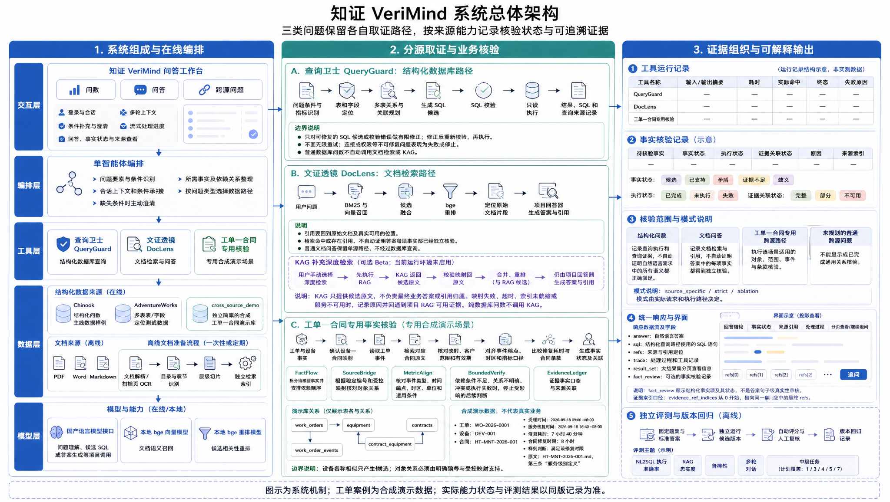
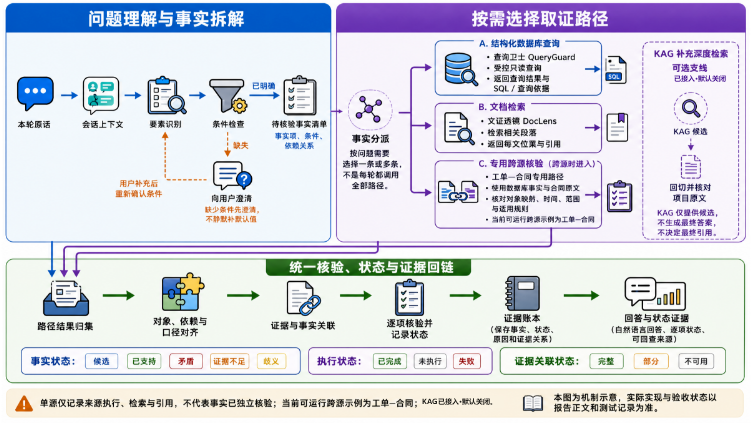
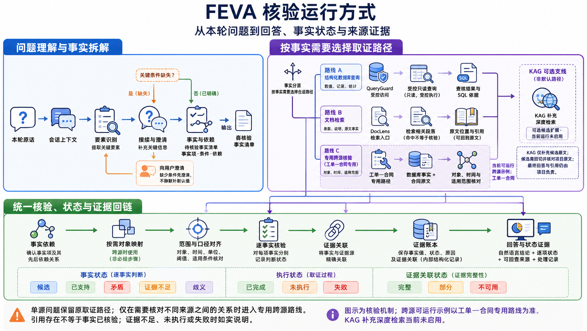
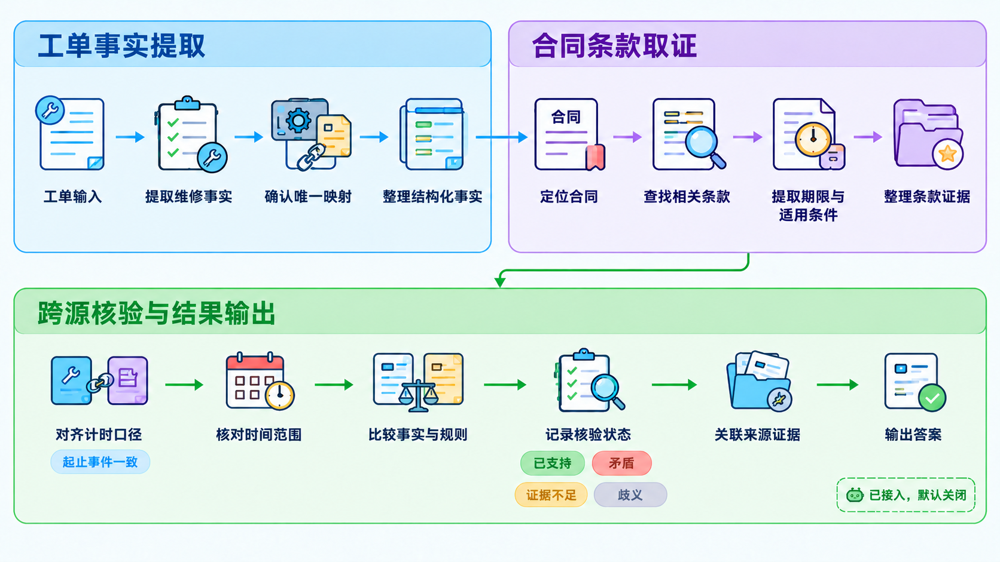
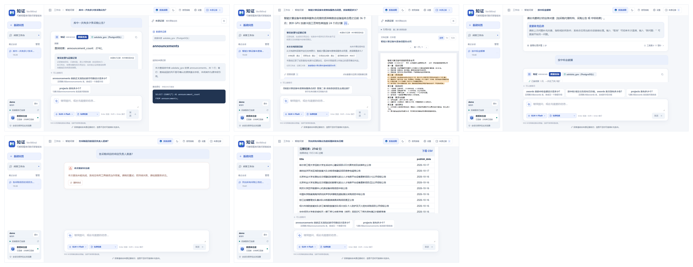

# 1 赛题理解与需求分析

## 1.1 项目目标与应用需求

知证 VeriMind 是一个面向数据库与文档两类数据源的可解释问答智能体：用户用自然语言提问，系统判断该查数据还是查文档，执行后返回带来源依据的可解释答案。

本项目面向第三届中国电子杯高校 ICT 产教融合创新大赛赛题八，开发多模态数据环境下的可解释精准问数问答智能体。用户通过自然语言提出问题，系统判断需要访问关系型数据库、知识库文档或两者，完成查询与检索，并返回答案和可核查的来源依据。[1]

产品展示名称为知证 VeriMind，整体运行机制称为事实—证据核验架构（FEVA，Fact–Evidence Verification Architecture）。其核心是“明确事实 → 执行取证 → 按适用规则检查 → 登记证据 → 组织回答”；机制详见第 2、4 章，当前实现对应工单—合同专用流程。[7] FEVA 是对本项目机制的命名，具体能力和适用范围仍以代码实现及实验结果为准。

企业业务信息分布在不同载体中。数据库保存交易、设备、工单和事件等结构化记录，合同、操作规程和技术文档则描述规则、条件和业务解释。业务人员往往需要把数据与规则结合，才能完成一次判断。项目因此同时建设数据库问数与文档问答两条主线，并研究如何在复合问题中建立可信的跨源关系。

系统设计强调三个目标。第一，查询结果应与用户对象、指标和时间条件一致。第二，文档答案应得到实际原文支持，保留条件和例外。第三，复合结论所依赖的对象关系和口径应经过明确核验，证据不足时给出可理解的澄清或限定回答。

## 1.2 赛题要求与能力对应

初赛详细评分表包括基础功能、性能、优化、文档质量和演示效果。本项目按这些项目组织实现和证据，不以架构图或模块数量替代实际测试。[1]

| 赛题要求 | 项目能力 | 需要提供的验证依据 |
|---|---|---|
| 基础单表查询 10 分 | 自然语言转 SQL 并只读执行 | 至少 10 个真实测试用例与执行结果 |
| 基础单文档问答 10 分 | 检索原文并回答 | 至少 10 个问题及原文核验 |
| 可解释性 5 分与交互可用性 5 分 | SQL、引用与执行过程展示 | 真实界面与实际响应对应检查 |
| 查询准确率 10 分与答案忠实度 10 分 | 结果比较与事实支持核验 | 固定题集、指标定义和逐题结果 |
| 系统效率 5 分 | 分析端到端耗时与瓶颈 | 模块复杂度及两种数据规模比较 |
| 中级任务 15 分 | 任务 1、3、4、5、7 分项实现，最终结论以候选版本证据为准 | 对照任务要求的实现与运行证据，逐项结论见表 3 |
| 鲁棒性 10 分与多轮 5 分 | 容错、澄清与上下文恢复 | 非理想输入及连续五轮以上对话 |
| 文档 10 分与演示 5 分 | 可读文档与可运行作品 | 同版材料、部署说明和功能呈现 |

表 1 评分项与自评口径对照

初赛至少完成一个中级任务是作品有效性的要求，中级任务评分封顶 15 分。本项目选择任务 1、3、4、5、7，因为它们分别对应输入理解、语义澄清、表字段定位、多表关联和文档结构识别，其中任务 1、3、4、5 构成结构化链路的连续环节，任务 7 作为非结构化数据的处理底座。[1][2]

## 1.3 主要难点

问数的主要困难是自然语言与数据结构之间的差异。别名、缺失条件、近似表名和错误关联路径可能产生可执行却不符合业务意图的 SQL。项目通过标准化输入、澄清缺口、依据结构目录定位候选及校验关联关系来处理这类问题。

问答的主要困难是文档结构与事实边界。扫描件需要文字识别，混乱目录影响切片归属，检索相关的片段也未必足以支持完整答案。项目把解析、章节组织、混合检索、重排和来源定位作为一条完整链路处理。

跨源问题还要求证明不同记录与文档对应同一业务对象，并统一指标、单位、时间和适用范围。项目围绕这些依赖设计显式事实核验流程，避免把候选相似性直接变成确定结论。

**证据与验证边界**　本项目各项能力处于不同的验证阶段。跨源事实核验有合成题集的封存对照结果；文档问答与多轮对话有冻结版本下的实测记录；数据库规模效率已取得三档实测，文档集合规模效率仍缺实测；真实界面联调已于 2026-10-18 在候选版本的单端口实例上完成（图 6 至图 10）；KAG 可选深度检索已接入但默认关闭，真实检索稳定性、召回质量与耗时尚未通过启用门槛，详见 7.1。各项能力的最终结论以对应章节所列的题集、版本和原始记录为准，未取得证据的部分保留待补状态。

# 2 总体架构与运行机制

## 2.1 系统分层与职责

系统采用交互层、编排层、工具层、数据层和模型层。交互层提供问答及证据查看入口；编排层维护会话状态、理解问题并调度工具；工具层负责 SQL 和文档处理；数据层保存业务记录、结构目录、语料与索引；模型层提供国产语言模型和本地小模型能力。[2]

图 1 系统组成与职责

工具采用统一的返回结构，将实际产出、调用记录和来源引用交给编排层。公共响应保留回答、SQL、引用、执行轨迹、澄清状态及结果集信息，使后端处理与前端展示使用一致的数据定义。

语言模型承担候选生成和自然语言表达。代码负责结构检查、只读执行、来源记录、业务核验及失败处理。当前前端采用 Vue，后端采用 FastAPI，业务库采用 PostgreSQL；本地 bge 模型用于文档向量化和重排。[3]

## 2.2 数据准备与在线处理

结构化数据保留在业务数据库中。系统读取表、字段、主外键和中文业务描述，形成查询所需的结构目录、别名和关系信息。文档侧支持 PDF、Word、Markdown 和 TXT，按文本层或扫描页选择抽取方式，再组织章节与片段并建立检索索引。

数据准备与在线问答分开。正常提问使用已经准备或加载的索引和结构目录，不把文字识别和文档解析误记为每题必经步骤。数据或语料更新后，重新准备相应资源，并在运行记录中注明版本。[13]

图 2 问题理解与工具调用流程

用户输入进入会话处理后，系统识别对象、指标、时间和筛选条件，进行标准化与必要的语义检查。条件缺失时请求补充；条件齐全时选择查询、文档问答或已启用的跨源实验路径。普通单源问题直接使用相应工具，不强制经过跨源核验。

## 2.3 主线与增强能力的组织

数据库问数和文档问答是交付主线。多跳检索属于文档工具的增强能力，通过前一次检索得到的事实构造下一次查询，并在最终上下文汇合后生成答案。启用方式和运行预算由配置控制。

跨源事实计划目前通过显式开关启用。当前已实现的专用入口是工单与合同规则核验；扩展到问数、文档问答与跨源三类问题的统一核验属于已认可的方向，代码处于实现中，尚未取得运行证据。其机制可作为跨业务扩展的基础，但当前不声称具备任意业务问题的自动事实分解能力。知识增强生成（KAG）的可选深度检索代码和前端入口已接入，但默认关闭、不进入常规问答主链路；用户显式选择且服务就绪时才运行，真实检索的稳定性、召回质量与耗时仍以专项实测为准。

## 2.4 FEVA（事实—证据核验）机制与三类路径

五层结构说明模块部署位置，FEVA（事实—证据核验）说明复合问题如何依赖事实、检查来源关系并记录证据。两种视图互相补充：前者回答"组件在哪里"，后者回答"结论凭什么成立"。[7]

系统对事实类问题采用统一的核验运行方式：接收用户原话与会话上下文；完成接续与澄清，明确本轮需要确认的事实；按事实类型分派到结构化查询、文档问答或跨源核验三条路径；对工具结果做一致性检查并关联证据；把已确认与未确认的事实写入证据账本（EvidenceLedger，编排层私有）；最后输出答案，并同时给出对应的事实状态与证据。[7][8]

三条路径共用同一条编排主干和同一套证据记录格式，差别在于取数工具与关系判定方式。结构化路径从业务库取数并保留表、字段与查询记录；文档路径检索语料并保留文档、章节与字符位置；跨源路径同时取用两者，并额外判断不同记录与文档是否指向同一业务对象。

证据账本以事实任务的形式记录每一条待确认事实及其显式依赖，逐条登记取值、确认状态与依据来源。未取得证据的事实保留未确认标记，不并入结论。该结构刻意置于编排层内部，不直接进入公共契约；对外只提供按响应版本协商的只读投影。

机制遵循一条判定边界：检索命中、被引用与事实已验证是三种不同状态，前两者都不会自动升级为第三者。这一边界使答案的可核对范围不取决于生成文字的表述，而取决于账本中记录了哪些事实及其证据。

图 3 FEVA 核验运行方式：从本轮原话到回答、事实状态与来源证据

**实现状态**：本节所述三路统一核验为已认可方向，代码处于实现中；目前可运行的专用入口是工单与合同规则核验。本节机制性描述不作为已实现承诺，未取得运行证据的部分以交付候选版本的实测记录为准。[7][15]

# 3 核心能力与中级任务设计
## 3.1 数据库问数

数据库问数将用户语言转为自然语言转 SQL（NL2SQL）查询。输入先识别业务别名、错别字、全角字符和相对时间，并记录改写依据；语义检查关注缺失的指标、比较范围等必要条件。对无法可靠确定的内容，系统保留缺口并请求用户补充。

这条结构化查询能力在项目展示中称为查询卫士（QueryGuard）。

表字段定位综合结构元信息、中文业务描述与别名，形成候选集合。多表规划根据已声明外键选择关联路径，考虑目标粒度、聚合关系及歧义。候选 SQL 由模型生成，执行前经 sqlglot 抽象语法树检查和关联语义检查，业务执行路径禁止写操作。

执行层使用只读事务，并配置超时、返回行数和字节容量限制。出现可修复的 SQL 错误时，有限次数地把错误回传到生成环节；连接或权限故障不依靠无限重写处理。大结果集通过会话绑定的短期缓存进行分页，结果截断时明确提示，禁止把不完整结果当作完整数据导出。

效率准备在业务库内建成三档同构规模表，行数分别为 1 千、1 万和 10 万，三档表结构相同、日期区间与取值分布对齐，使同一逻辑查询在不同规模下具备可比性。规模表置于独立模式中，不改动既有业务表的表数与字段数断言；实测基础设施校验通过 21 项、失败 0 项，业务模式下的基表数仍为 11。[6]

三档规模表的耗时结果与执行行为观察统一在测试章节报告，本节不给出推算数字。三档覆盖题面要求的两档规模，正式计时按其中两档报告。本轮计时为服务已就绪状态下的单轮端到端观测：每档 10 个查询各发一次请求，按档统计 p50、p95 与最大值，未做冷启动隔离与轮间缓存清理，也不按三轮取中位数；该组数字用于同一环境内的横向规模比较，不作为对外服务承诺。[6]

该模块已在合并版本上完成一次真实链路全量运行，方言为 PostgreSQL，分项结果见表 2。失败集中在多表关联与排序两端，与设计预期一致；两项分别对应评分表中「NL2SQL 执行准确率」与「鲁棒性」两栏的档位判定依据。

| 题集 | 题数 | 通过 | 比例 | 分项构成 |
|---|---|---|---|---|
| 结构化问数 | 15 | 11 | 73.33% | 单表 7/8、多表 4/7、含排序要求 7/11；难度 简单 5/5、中等 5/5、困难 1/5 |
| 鲁棒性 | 18 | 16 | 88.89% | 退化输入 14/16（87.50%）、该澄清时澄清 2/2（100%） |

表 2 结构化问数与鲁棒性分项结果

失败样本的形态比通过率更有信息量。四道结构化失败题中，有两道是同类错误：生成的 SQL 引用了并不存在的列（`artist_id`），链路的结构校验没有拦住这处凭空编造的外键；一道把月份硬编码成运行当日所属年份，落在无数据区间而返回 0 行；一道返回列数与预期不符。鲁棒性剩余两题中，一道同属编造外键，另一道结果集内容正确但排序方向与要求相反。

相对时间题目的处理暴露了一处明确缺口，逐题对照见技术实现说明书第 7 章。用例文件中七道相对时间题带有统一的时间基准，按基准运行后七题结果集全部判为通过；按区间逐题比对，只有四题的预测区间与标准区间一致，另三题并不相同：「去年」相差整年，「上个月」相差整月，「上个季度」相差整季且未按季度边界对齐。它们之所以仍被判通过，是因为业务库中这些相邻周期的计数恰好相同——四年发票总数均为 83 张，2024 年的两个相邻月份各 7 张，第一季度与第四季度各 21 张——区间算错也得到同一个数字。

因此这七题的「全部通过」不能作为相对时间解析正确的证据：区间一致的四题中，只有 `rob-16`、`rob-18` 两题的数据具备判别力，另两题即便解析错位也不会改变数字；三题区间错误则完全被计数巧合掩盖。更深一层的原因与判分无关：执行前的要求核验器对时间条件一律判为"无法静态证明等价"后放行，并未比对区间，所以即便数据具备区分能力，写错区间的 SQL 也不会被这一步拦下。该缺口已定位到 `app/nl2sql/requirement_validator.py` 的 `_check_time`：归一化环节已算出确定的左闭右开区间并存放在 `NormalizeResult.times`，但核验器取用的是原始表述而非归一化结果，无法从中抽出年份，于是无论 SQL 写成什么区间都只能判为不可证。此项属已知缺口，本轮未修复，是后续把时间类要求的核验从"不可证即放行"推进到"按区间比对"的入口。

上述判别力限制并非本题集独有，而是评测设计需要长期注意的一点：用真实业务库做回归时，若某类错误恰好不改变结果数字，判分器就无法发现它。因此本项目在报告数字时同时给出逐题区间对照，而不只报通过率。

## 3.2 文档检索问答

检索增强生成（RAG）首先把文档解析为带来源定位的文本块。扫描 PDF 逐页执行离线文字识别；文本规范化处理断行和表格行；目录识别依次利用内嵌书签、编号与字号线索，切片保留章节路径、页码和可得版面坐标。

这条文档处理和检索能力在项目展示中称为文证透镜（DocLens）。

在线检索同时使用 BM25 关键词匹配和本地 bge 向量召回，按排名融合后由 bge 重排模型筛选上下文。关键词通道补充编号和术语匹配，语义通道补充近义表达；候选命中仍须与具体问题和原文条件一起检查。

答案生成受到检索上下文约束，引用标记映射到实际片段。前端可打开文档来源；真实版面坐标存在时显示区域高亮，缺少坐标时只提供可得的页码、章节或文本定位。约束提示和引用解析提供可审查基础，但不保证所有生成事实都已自动核验，因此仍须进行忠实度评测。

忠实度评测沿用同一条问答链路，分别以单轮检索与多跳检索两种检索配置，在文档问答题集（15 条）与多跳题集（20 条）上各跑三轮，共 12 批。两种配置的差别只在于是否由前一次检索结果构造下一次查询，其余环节一致。四组结果见技术实现说明书第 7 章；最低一组贴近评分档位下沿，因此对外应报区间而非常数。该结果对应评分表的 8 分档，距 10 分档尚差约 8 至 10 个百分点。评测代码指纹为 bdb5edf。[14]

失败题共 20 题，归因见技术实现说明书第 7 章；漏掉的内容集中在数字、编号、公式与条款名等精确型事实。检索命中率由答案引用近似推算，属低估口径，不作为检索能力对外报数。[14]

上述 12 批结果来自代码指纹 bdb5edf 的冻结版本。另有一次更晚版本的真实链路全量运行，两批数据的题目版本、代码版本与判定器均不相同，**互不可比，也不作为改进幅度的证据**，此处仅登记其数值：文档问答题集 21 条命中率 76.19%、忠实度 84.76%、单题通过 17/21；多跳题集 20 条命中率 90.00%、忠实度 79.58%、单题通过 9/20。该次运行的预测产出与判分报告已随代码入库，可逐题复核。

该次运行同时暴露了三项已知边界，均已完成定位并如实登记，不通过调参或放宽判据消除：

一是隐式推理类多跳题存在未修复错误。题目 `rag-mh-09` 要求依据事故等级反推启动主体，源文档 5.4 条只写明"Ⅲ级响应由分管副总指挥启动"，答案却给出"Ⅱ级响应由分管副总指挥启动"，把相邻等级的启动主体错挂到被问等级的头上，命中该题登记的禁答实体；三次重复运行结果一致，属稳定错误而非偶发。二是该错误无法用提示词约束修正：在上下文冻结的前提下对照四版提示词（基线、系统级等级归属铁律、先逐级照抄原文再作答、点名错误模式并给出反例），四版均未阻止该错挂，其中"先照抄"版已把 5.4 条原文正确抄出，作答阶段仍然错挂，说明错的是推理骨架而非材料可见性。三是扩宽召回不能解决：该题融合召回候选池仅 14 条，未填满当时的 20 条名额，逐档扩大召回宽度不会新增任何候选；缺的是跨章节补充检索，属多跳分解与跨轮重排环节的问题。

此外更正一处既往归因：`rag-mh-09` 原在 2026-10-05 的失败题归因中被列入"判定器对除外清单类表述的假阳性"，经本次逐题复核，该题答案确为事实错误，属判定器正确拦截，不属于假阳性；同批并列的另外三道题未在本次复核范围内，其归因维持原记录。

## 3.3 中级任务与能力链

| 任务 | 主要方法 | 实现位置 | 最终验证结论 |
|---|---|---|---|
| 1 要素识别与改写 | 口语、简称与错字对齐到规范字段名；无法确定时不猜测，保留为待澄清项 | `app/nl2sql/normalizer.py` 的 `normalize()`；别名与列说明取自 `infra/schema_meta*.json` | 已运行开发回归：单表 20 道中答案正确 17、误拦澄清 2、答错 1，均值 12.2 s；题集以单表问数为主，不构成要素识别独立指标 |
| 3 语义校验与澄清 | 逐项核验必要条件是否齐备；缺项时发起澄清并在会话状态中保留待定项 | `app/nl2sql/requirement_validator.py` 的 `RequirementValidator`；`app/clarifier.py` 的 `SemanticClarifier`；`app/memory.py` 的会话槽位 | 已运行：20 场景 43 轮全部完成；19 条已执行 SQL 中 14 条经只读重放与答案对应，5 条不匹配；属重放对应审计，不是判定清单通过率 |
| 4 精准表定位 | 按表名、中文业务描述与别名召回打分，再用外键关系补全候选表集合 | `app/nl2sql/linker.py` 的 `SchemaLinker`；`app/nl2sql/join_planner.py` 的 `JoinPlanner` 与 `_foreign_edges()` | 已运行开发回归 20 道：严格结果一致 13、执行成功 13；绑定旧候选 1fcaf42d，图谱后端为 mock、向量定位未启用 |
| 5 多表关联查询 | 沿已声明外键求最短关联路径；对关联完整性与结果粒度做一致性校验 | `app/nl2sql/join_planner.py` 的 `JoinPlanner`；`app/nl2sql/semantic_validator.py` 的 `SqlSemanticValidator` | 已运行开发回归 20 道：严格结果一致 16（80%），结果错误 1，未形成可评分结果 3 |
| 7 不标准目录识别 | 书签、条款编号与字号三条识别路径重建标题层级，按层级切片并保留章节归属 | `app/rag/ingest/toc.py` 的 `build_tree()`／`build_tree_by_numbering()`／`build_tree_by_fontsize()`；`app/rag/ingest/chunker.py` 的 `build_chunks()` | 已运行解析：目录混乱版 KB-015 识别 5 个章节节点，扫描件 KB-008 识别 0 个（需复核的风险信号）；尚无判定清单数值 |

表 3 中级任务分项实现与结论

第四列登记的是各任务在对应版本上的开发题运行事实，逐项数字、限制与证据路径见中级任务测试成绩台账[18]；前两列按当前代码登记到具体模块与函数，可直接对照仓库核查。这五套题集均为已曝光开发题，属当前实现回归，不是盲测或未见题泛化结果，也不等同于赛事中级任务分项得分。其中任务 1 的原始运行目录已不存在，只能引用历史汇报，且题集以单表问数为主；任务 3 的 14/19 是只读重放与答案的对应审计，不是判定清单通过率；任务 4 的成绩绑定旧候选 1fcaf42d，且当时图谱后端为 mock、向量定位未启用；任务 7 只有解析输出，逐页人工核对表尚未建立，扫描件识别为零章节的结果须复核。合并版本上的结构化与鲁棒性回归见 6.1，政采业务库上的五套题见 6.4，多轮澄清证据见 3.4。[4][10][16][18]

## 3.4 多轮与非理想输入处理

系统按会话标识维护待澄清条件和最近问数上下文。用户补充条件时恢复原任务，取消或新问题可替换待处理内容，交错会话分别保存状态。当前后端会话状态在单进程内存中，服务重启或状态过期后需重新提供条件。证据账本按请求隔离，追问可以继承问题条件与查询状态，但不能把历史证据当作本轮证据；对象、时间或口径变化后需重新取得受影响的事实及下游结论。[7]

鲁棒性测试覆盖别名、错别字、模糊输入、缺条件、空结果及非标准文档。失败信息和安全拦截作为实际结果保留；正常返回与正确作答分别统计。

多轮对话已有一次冻结版本下的真实链路实测：题目内容 SHA-256 为 BF1BF646DCD7393CA59ACC756FE7E4A5F6311CA814BA75B3393CAB3E7BE66C2E，代码版本为 d03c3d9，共 4 条用例、每条 5 轮，计 20 轮中通过 19 轮；按"一条用例 5 轮全部通过才算通过"的口径，4 条用例中 3 条通过。该口径只检验追问是否接上上文以及是否答到本轮要点，与问数和文档问答的准确率、忠实度是两套独立指标。[5]

该实测同时暴露一个已定性的功能缺口：用例 mt-03 第 2 轮"他总共消费了多少？"已接上上文，但未切换查询对象，仍重查客户档案表，未取到该轮期望的发票金额。根因是 app/nl2sql/followup.py 的 resolve_followup() 只覆盖五类显式操作，对"消费总额""花了多少钱"等同义说法不识别，因而未进入后续的查询校验与失败回灌路径。该缺口属待扩展功能，本轮未修复，已在测试章节继续跟踪。[5]

最终候选环境下的容错结果在测试章节统一填写。

# 4 跨源事实核验

## 4.1 跨源融合的设计含义

跨源融合是把数据库中的业务事实与文档中的规则或解释组织进同一问题的回答。系统先确定需要回答的事实及其依赖，按数据源取得候选依据，再验证对象对应和口径，最终把每项结论关联到来源。仅同时调用 SQL 和 RAG，不足以完成可信融合。

图 4 工单—合同专用流程的事实依赖与核验

当前专用事实计划先取得工单设备和日期，再检查设备与合同的映射依据、唯一性、客户、合同状态以及映射与合同各自的有效期。事件时间事实得到支持后，定向检索合同文档，核验范围、修复时限和特别约定。最后统一口径并执行确定性比较。

项目将这条机制称为事实流（FactFlow）：先组织事实及其依赖，而不是先组织查询语句。事实流决定本问题需要哪些事实、它们之间的依赖顺序，以及某一事实未获支持时哪些下游事实不再执行。

跨源证桥（SourceBridge）核对数据库记录与合同文档的对象关系：设备的业务编号与合同标的之间是否存在受控映射、映射是否唯一、是否在有效期内。相同名称只构成候选，不构成桥接依据。

口径对齐（MetricAlign）核对事件、时间与合同三类定义的一致性：事件时间与合同有效期是否落在同一口径、响应与到场与恢复是否被混为同一指标、修复时限的起算点是否一致。

证据账本（EvidenceLedger）保留每条事实的取值、确认状态与依据来源。它是编排层私有的执行状态，不是面向用户的引用面板；对外只提供按响应版本协商的只读投影。

有界求证（BoundedVerify）限制补查轮次并处理依赖失败：为每个事实设定补查上限，依赖未获支持时停止下游执行，保留已确认事实并给出限定结论。

事实记录保存取值、校验状态和证据关系。依赖未得到支持时，执行器记录未执行原因，保留前面已确认的事实并给出限定结论。停止时机仍需按实际轨迹检查；本设计不把所有阻断题都描述为必定在文档检索前停止。

当前实现对应工单—合同专用流程，已在下一节的受控对照中取得配对结果，尚不代表任意领域的通用自动核验。扩展到问数、文档问答与跨源三类的统一核验属于已认可的方向，代码处于实现中。

## 4.2 跨源核验与单源问答的差别

项目的架构改进集中在显式事实依赖、跨源关系核验、证据关联和有界处理。其目标是减少错误套用来源、口径混淆及无依据的肯定结论，同时避免材料齐全时的不必要拒答。贡献需要通过同条件流程对照和失败分析论证，不能仅凭组件不可缺少或模块数量得出创新性结论。

该论证在 64 道合成题上以双臂配对方式完成，两支流程使用同一题集与同一评分口径，结果与限制见 6.2 的受控对照。这里的重点不是单个组件是否不可缺少，而是同一题集下两支流程的逐题差值、以及这些差值在何种范围内成立。[4]

关系核验具有明确业务边界。设备名称相同只形成候选，稳定编号和受控映射才能支持桥接；合同有效期与映射有效期分别检查；响应、到场与恢复属于不同指标，不直接互换。来源冲突没有明确消解依据时，系统限定结论。

# 5 产品交互与可解释展示

用户在工作台输入自然语言问题，看到回答、来源卡片和实际执行路径。SQL 结果可以查看查询语句及记录来源；文档回答可以查看原文片段和可得的定位信息。执行过程按工具调用记录展开，展示每一步的输入、输出、耗时和命中来源。除正常结果之外，错误、超时、无结果与需补充条件也各有独立呈现，澄清后可在同一会话内继续回答；结果集过大时分页展示，并可导出。[11][12]

## 5.1 从证据账本到界面呈现

交互围绕一条主线组织：问题需要哪些事实、这些事实怎样核验、结论由哪些证据支持。这条主线的后端载体是第 4 章的证据账本，界面不直接读取账本，而是消费按响应版本协商返回的只读投影。[11]

展示范围由各条路径实际产生的结构化记录决定，而不是由界面统一包装。文档检索到引用不等于答案事实已验证，因此投影中记录的是每条事实的目标、真实检查状态与证据引用三项，界面按这三项渲染，不能把引用存在或执行成功显示为事实通过。[11][12]

这一约束在界面上表现为几种明确标注。单源问数与文档问答当前标注为"来源执行记录 · 未作事实级判定"，因为其事实级检查器尚未接入；跨源路径中缺少关系检查器的环节明示"关系未核验"。投影只在后端返回对应版本的记录时出现，旧版后端与未协商的响应保持原有呈现，不做兼容性推断。界面呈现的完整性由投影版本与检查器覆盖范围共同决定，未覆盖的事实保留为未判定状态，不省略、不折叠为通过。[12]

**实现状态**：本节所述的投影呈现对应 2026-10-15 的实现候选，已完成构建与受控界面检查。2026-10-18 在政采业务库上完成单端口部署的真实前后端联调，单表问数、文档问答、澄清续答、失败提示与大结果浏览五个场景均取得界面记录（表 4）。界面呈现规则本身已经生效；各条路径在真实业务问题下的逐项表现仍以交付候选版本的实测记录为准。[11][12]

## 5.2 交互设计原则

交互设计把答案与证据放在同一工作流程内，用户可从结论转到具体来源。错误、超时、无结果及需补充条件有独立呈现；查询截断不能伪装为完整结果。浏览器历史与服务端会话状态分别保存，健康检查只表明接口连通，不表示模型和数据库已完成实际业务验证。[12]

构建与受控界面检查结果不替代真实前后端联调。[11][12]

| 展示项目 | 截图或证据编号 | 候选版本 | 核查结果 |
|---|---|---|---|
| 单表查询与 SQL 展示 | 图 6 | f0246ab + 包内 web/dist | 答案 2742 与查询语句、数据来源 askdata_gov 同屏 |
| 文档回答与原文引用 | 图 7 | 同左 | 答案带引用角标，引用卡标第 1 页与章节，右侧原文高亮 |
| 澄清后继续回答 | 图 8 | 同左 | 首轮要求补充条件，次轮续答标注已续接首轮 |
| 错误与超时提示 | 图 9 | 同左 | 运行失败按提示呈现，工具错误未当作答案，提供重试 |
| 大结果分页及导出 | 图 10 | 同左 | 结果 2742 行，可按页浏览并下载 CSV |

表 4 交互与可解释性展示项目

图 6 至图 10 最终候选界面

上图为同一候选版本上真实前后端联调所得的五个场景，按图 6 至图 10 顺序排列，均取自政采业务库的单端口部署实例。受控检查的具体范围与判据见参考资料。[11][12]

# 6 测试结果与效果分析

## 6.1 测试分类与判分

主线验收、已曝光开发回归和独立留出对照分别报告。SQL 正确性通过实际结果与独立参考结果比较；文档问答检查必需事实、条件及原文支持；引用和执行轨迹另外检查。空答、拒答、超时及运行失败全部保留，不从原始题数中静默删除。

主线指标在固定候选、题集与判据后登记，开发回归与独立留出分开报告：判分口径、错误分类与逐题复核方式见技术实现说明书第 7 章，本报告只登记验收结论，不重复实验设计。空答、拒答、超时及运行失败一律保留在原始题数内，不从分母中静默删除。[16]

| 最终验收项目 | 题数或场景数 | 正确或通过数 | 比例 | 数据与运行版本 |
|---|---|---|---|---|
| 基础单表查询 | 8 | 7 | 87.50% | 合并提交 `9f3e6a9`，PostgreSQL |
| 基础单文档问答 | 21 | 17 | 80.95% | 同上，忠实度 84.76% |
| NL2SQL 结果准确率 | 15 | 11 | 73.33% | 同上，见 3.1 节 |
| RAG 答案忠实度 | 21 | — | 84.76% | 同上，忠实度均值非通过率 |
| 连续五轮以上对话 | 4 条用例 20 轮 | 3 条用例 19 轮 | 95.00% | 冻结版本实测，见 7.4 节 |
| 非理想输入鲁棒性 | 18 | 16 | 88.89% | 合并提交 `9f3e6a9`，见 3.1 节 |
| 可解释性与溯源展示 | 5 个场景 | 5 | 100% | `f0246ab`＋包内 `web/dist`，政采业务库，2026-10-18，见图 6–图 10 |
| 界面可用性与演示 | 5 个场景 | 5 | 100% | 同上；含失败提示与重试、分页与导出各一例 |
| 最终前后端联调 | 1 套单端口部署 | 通过 | — | 同上；单进程同时提供界面与接口，真实登录、真实库、真模型档 |

表 5 最终验收项目与结果

表中前三行与第六行来自合并提交 `9f3e6a9` 上的真实链路运行，预测产出与判分报告随代码入库，可逐题复核。「基础单文档问答」记的是判分器判定的整题通过数，含多跳题在内；「RAG 答案忠实度」记的是同一批题的忠实度均值，与通过率是两套指标，故不填通过数。「连续五轮以上对话」一行沿用冻结版本记录，其判据只检验追问是否接上上文并答到本轮要点，与准确率、忠实度互相独立。后三行于 2026-10-18 在 `f0246ab` 快照的单端口部署实例上完成真实前后端联调，五场景界面记录见图 6 至图 10；其判据是界面是否按既定要素呈现来源与失败提示，不是答案正确率，事实级投影的覆盖范围见 5.1。表中数字的口径与判别力限制见 3.1 节与 7.4 节。

## 6.2 已核验的跨源实验

CS18 v0.6 使用 64 道合成业务题，对新事实核验流程与匹配参考流程进行配对运行，共封存 128 条回答，运行错误为零。主指标为严格通过，即最终人工评定中正确性为"正确"且证据为"充分"。两位评审初评产生 19 条分歧，由第三人裁决后合并，再按受控流程解盲。[4]

| 指标 | 新事实核验流程 | 匹配参考流程 |
|---|---|---|
| 严格通过 | 62/64 | 7/64 |
| 严格通过比例 | 96.9% | 10.9% |
| 配对差 | +55 题 | +85.94 个百分点 |

表 6 CS18 v0.6 严格通过指标配对对比

图 5 CS18 v0.6 本批合成题的描述性结果

本批结果支持当前事实核验流程在受控场景上的有效性。数据为合成题，参考流程为本项目的匹配对照，结果不代表真实业务准确率，也不是与全部现有系统的算法比较。实验未满足评审者独立随机化候选顺序，存在两题多合同判断后的晚停控制流，以及合同状态原因码的协议优先级开放项；这些限制随结果一并披露，不据此宣称完整确认性验收。[4]

## 6.3 系统效率

效率以用户提交至完整响应的端到端时间为主要观察范围，并分解索引准备、模型加载、查询、检索、重排和生成。冷启动与稳定运行分别记录，数据库与文档集合两类链路各采用两种数据规模，以同类问题和统一配置比较。赛题允许提供实测或预估，但预估必须标明假设，不能与实测混报。[1]

| 规模与链路 | 数据规模 | 冷热状态 | 中位耗时 | 尾部耗时 | 测量版本 |
|---|---|---|---|---|---|
| 小规模数据库 | 1 万行同构规模表，10 道单表查询 | 热态，未做冷启动隔离 | 3612 ms | p95 12511 ms，最大 15506 ms | 2026-10-18 单轮冻结运行 |
| 较大规模数据库 | 10 万行同构规模表，10 道单表查询 | 热态，未做冷启动隔离 | 3346 ms | p95 10119 ms，最大 13309 ms | 同左 |

表 7 系统效率计时记录

表中数据库两行为实测值，取自同一套同构单表题的端到端客户端观测，另附 1 千行档作为对照（中位 3406 ms、p95 10354 ms、最大 15123 ms）。三档中位耗时集中在 3346 至 3612 ms 之间，差异远小于档间行数差（百倍），说明该场景的耗时由意图改写、生成与语义校验等固定环节主导，10 万行以内的规模表不构成瓶颈；受样本量与外部模型网络波动影响，三档之间的先后顺序不作为规模劣化的证据。每档 10 个查询各发一次请求，属单轮观测，未清缓存、未做冷启动隔离，也未按三轮取中位数，故该组数字只用于同一环境内的横向比较。文档集合两档规模本轮未实测，不填推算值。[6]

同一套题在 2026-10-12 的三轮运行与 2026-10-18 的单轮运行给出同向结果：HTTP 全部成功，严格匹配的差异都只出现在月键的日期与文本表示上，语义归一后一致；执行行为的逐项统计见技术实现说明书 7.6。

## 6.4 政采业务数据测试

前述各节的数据与题集基于示例业务库与合同类文本。为验证同一套机制在真实业务数据上的表现，另建政采业务库并按业务问法独立命题。结构化部分 11 张表、合计 15,418 行（其中 2,742 行为公告正文全文库，结构化业务记录 12,676 行），覆盖采购公告、项目、标包、品目、中标结果、供应商、采购人与代理机构；文档部分为公告原文与法规，公告全量 2,742 份、公告类型 10 类、覆盖 31 个省级行政区，其中 224 份进入切片索引、共 2,305 个切片；交付包不含向量索引快照，重建时须按同一批语料灌库，文档问答结论以独立评测记录为准。

题集不沿用示例库题目。命题方法是先用黄金 SQL 在库内跑出真答案、再据答案写题面，确保每题有非空的确定结果；文档侧的规则原文片段由脚本按锚点截取，不靠人工转录。五套题共 77 题，另有多轮对话 4 个用例 20 轮，覆盖情况见表 8。

| 测试类别 | 题量 | 覆盖内容 | 记录状态 |
|---|---|---|---|
| 结构化单表与聚合 | 30 题 | 单表统计、分组排序、时间范围、跨表关联、空值边界 | 已跑通并留档 |
| 文档单源问答 | 14 题 | 法规条款问答、公告要素提取与引用定位 | 已跑通并留档 |
| 跨源融合 | 15 题 | 同一问题在库侧与文档侧同时取证 | 已跑通并留档 |
| 鲁棒性 | 18 题 | 错别字、业务别名、口语表述、时间指代、该澄清时澄清、退化输入 | 已跑通并留档 |
| 多轮对话 | 4 用例 20 轮 | 指代承接、维度追加、指标切换、时间收窄 | 已跑通并留档 |
| 合计 | 77 题 + 20 轮 | — | 逐套记录见附件 |

表 8 政采业务数据测试覆盖与留档

万行规模的效率观察不在这五套之内：它使用 6.3 所述的确定性同构规模表，与政采业务库的题集相互独立，两者不可相加，也不可互相替代。

逐题判定、失败分类与已知边界完整记录在随源码包提交的《政采业务库与测试记录》，本节只登记覆盖范围与留档状态，不在此重复逐套通过率，以免与本报告 6.1、6.2 的受控对照结果混读。该记录与本报告口径一致：低分项已逐题定位到具体代码位置，未通过项按已知边界原样登记，不通过调参或放宽判据消除。[17]

# 7 当前边界与交付计划

系统已有数据库问数、文档问答、澄清、多表规划、来源展示及跨源专用事实核验的实现。当前交付工作集中在统一候选版本、主线逐题核验、任务 7 问题修复和真实界面联调。最终是否达到对应评分档位，以同版测试及提交材料证据为准。

当前跨源计划仍有业务范围限制，KAG 可选深度检索已接入但默认关闭，真实效果仍待专项验证；本地模型资产与外部生成接口对运行环境有要求。后续扩展应优先增加不同业务数据和自然文档的覆盖，检查证据完整度、错误肯定与过度拒答，并同时关注耗时和维护代价。

结构化链路另有一项本轮复测确认、但未修复的既有缺陷：表字段定位已认出问题点名的相关表，其中得分低于规划阈值的表会被关联规划丢弃，模型据其写出的正确 SQL 随后被语义校验判为“使用了未纳入定位结果的表”并要求修复，实际运行的代价是一次多余的大模型调用。两条候选修法均经实测否决——把这类表降级为可选表仍需为其补上外键边，在宽表库上会使规划边数由一条扩至数条，破坏“只沿已声明外键推导最短关联路径”的契约；降低筛选阈值则会使十五道结构化题中十道题的规划表集合改变，无关表被纳入必用集合。该缺陷因此按原状记录，属定位环节准确率问题，与相对时间核验、澄清闸门等本轮已修项相互独立，修复需对定位打分与可选表机制整体重新设计，细节见技术实现说明书对应章节。

## 7.1 KAG 深度检索增强（可选扩展路径）

KAG 增强路径（原代号 Gap2Graph）在文档跨跳关系或证据缺口出现时补充候选原文。项目 RAG 仍是默认文档检索路径；用户可手动选择深度检索，由 KAG 补充候选，再由项目完成身份映射、去重、排序、范围检查、事实核验与最终回答。KAG 不负责生成面向用户的业务答案，纯数据库问数也不调用该路径。[8][9]

接入代码、请求契约与前端入口已按契约落地，定向测试 78 项通过，覆盖请求兼容、失败回退、候选边界校验、原文坐标映射与重排链路；接口与候选融合逻辑按契约工作，但这不证明该路径在业务题上的召回质量，实现细节见技术实现说明书。[9]

真实检索尚未通过启用门槛，这也是它保持可选、不进默认链路的原因。烟测结果见表 9：同一跨文档请求在候选预算 8 时返回 8 条、可映射回来源 5 条，目标来源之一未出现；预算翻倍到 16 后返回 11 条、映射 6 条，目标仍未出现；同一问题在不同次调用间结果不一致，观察耗时约 24 至 138 秒，样本不足，不足以当作性能分布。其中**同题重复调用的结果一致性**是独立门槛：一个结果不可复现的检索源无法进入任何固定题集评测，因此在完成稳定性统计之前，该路径只作为用户可手动选择的可选扩展保留，后端补充模块也未随本次交付候选提交，界面选项显示为未就绪。

| 轮次 | 候选预算 | 返回候选 | 可映射回来源 | 未映射 | 目标来源是否出现 |
|---|---|---|---|---|---|
| 第 1 次 | 8 | 8 | 5 | 3 | 未出现 |
| 第 2 次 | 16 | 11 | 6 | 5 | 未出现 |

表 9 KAG 补充候选烟测记录

启用前须完成索引构建身份审计、异常文档逐份核查、固定题集上的必要来源召回与回切成功率统计、同题重复调用的结果一致性统计与可接受交互时限的预先确定；该支线的结果单独记录，不与跨源工单实验合并计算总体准确率。[8][9]

## 7.2 交付信息登记

| 交付信息 | 最终填写值 |
|---|---|
| 提交候选完整代码提交号 | `f0246ab`（2026-10-18 交付包快照）；正式提交标签在提交日锁定，本表随包重建 |
| 设计报告审核日期 | 待提交前填 |
| 技术实现说明书审核日期 | 待提交前填 |
| 统一测试与评分版本 | 各章表内数字分别对应 `9f3e6a9`（合并后主线运行）、`986ab1c`（中级任务专项）与 `f0246ab`（交付包快照）；同一张表内不混用版本 |
| 异机启动与演练记录 | 2026-10-18 在 `D:\verify` 独立副本上首次演练：依赖安装与建库通过，暴露两处阻断（缺种子材料、副本无账号），已在交付包内修复，待重跑，明细见说明书表 16 |
| 源码包及数据清单摘要 | `release/verimind-src-20261018.zip`，2,518 个文件、27.4 MB；含政采库快照与 `MANIFEST.json` 逐文件 SHA-256，明细见包内《目录说明》 |

表 10 交付信息登记

除两处审核日期外，本表各值在打包时即已确定，不再随时间变化；审核日期与正式提交标签在提交当日补齐。

# 8 结论

本项目交付的是一个可运行的多模态问数问答智能体：单一自然语言入口，按问题需要分派到数据库问数、文档问答或跨源核验三条路径，并把每一步的工具调用、执行语句、命中表字段与引用原文记录为可核查的证据。机制层面的产出是事实—证据核验架构（FEVA）的五个组件——事实流（FactFlow）、跨源证桥（SourceBridge）、口径对齐（MetricAlign）、证据账本（EvidenceLedger）与有界求证（BoundedVerify）；工程层面的产出是自研编排层、只读 SQL 校验、结构目录定位、混合检索与界面侧的来源面板。

在证据层面，本报告给出的是分项、分版本、带适用范围的数字，而不是一个总分：示例库上的结构化问数 11/15（73.33%）、非理想输入 16/18（88.89%）、文档单源与多跳问答的忠实度分别为 84.76% 与 79.58%；跨源核验在 64 道合成题上的双臂配对对照为 62/64 对 7/64，配对差 85.94 个百分点；万行规模下三档数据的中位端到端耗时集中在 3.3 至 3.6 秒。真实业务库另建有政采库题集，五套共 77 题与 4 个多轮用例 20 轮，题量、覆盖与留档状态见表 8，逐套结果按记录文档原样随包提交，本报告不在此重复逐套通过率。

需要如实说明的边界有四类。其一，统一的跨源核验仍在实现中，已取得配对结果的只有工单—合同专用流程；其二，KAG 可选深度检索未通过启用门槛，同一问题重复调用结果不一致，因此保持默认关闭；其三，文档集合规模的两档效率尚无实测，本报告不以推算值填充；其四，结构化链路的表字段定位存在一项已确认但未修复的缺陷，八道结构化题与多跳题集中的一道按已知边界原样登记，不通过放宽判据消除。

后续工作的排序由证据缺口决定，而不是由功能数量决定：先完成统一核验在三条路径上的落地与同版复测；再重新设计定位打分与可选表机制，消解上述既有缺陷；然后补齐文档侧规模效率与多轮追问的覆盖；最后处理国产化数据库适配与部署简化——换库在实现上只应改动 SQL 方言参数，不应波及业务链路。

# 参考资料

## 一、赛事要求

[1] 中电云计算技术有限公司 赛题八题面原文 校内初赛要求与评分见原 PDF 第 8 至 11 页 仓库保存于 docs/reference/赛题八_题面原文.txt。

## 二、项目规约

[2] 项目根目录 AGENTS.md 项目口径、技术边界、交付规范与协作要求。

[3] 项目功能清单与技术框架 v1 功能三档清单、选型决策与目录结构 docs/功能清单与技术框架_v1.md。

## 三、实验记录

[4] CS18 v0.6 受控解盲与配对结果 2026-10-10 保存于 eval/reports/cross_source/cs18_v06_unblinded_20261010/ 包含报告、配对汇总与逐题证据索引。64 道合成题双臂配对、描述性结果与三项已知偏离详见报告结论边界一节；引用其配对数字须同时披露该节限制。

[5] 多轮对话上下文保持实测 2026-10-14 docs/多轮对话上下文保持实测_20261014.md 冻结题目 SHA-256 BF1BF646DCD7393CA59ACC756FE7E4A5F6311CA814BA75B3393CAB3E7BE66C2E 与代码版本 d03c3d9 下的单次真实链路运行；同批另有 B 线候选运行摘要 candidate_run_summary.md，指定 RAG 版本 fa8abd1、前端版本 f2a61c1，两版本尚未完成整合验收。

[6] 结构化规模效率实测 2026-10-12 docs/结构化规模效率实测_20261012.md 三档规模表的数据基座、校验结果与计时口径；本文件不含未经实测的性能数字。计时与严格匹配的实测数据见 `eval/reports/scale_run_20261018T031516`（含冻结清单 `freeze.json`、原始回答 `raw_answers.jsonl` 与评分文件 `structured_scale_score.json`），按 6.3 所述单轮口径观测。

[7] 三类问答统一核验架构实施计划 v0.1 2026-10-15 docs/architecture/三类问答统一核验架构实施计划_v0.1_20261015.md 方向已认可，2026-10-15 已在隔离功能分支开始实现，代码与契约尚未经测试或真实接口验收。

[8] KAG 深度检索接口预留与接入交接 v0.1 2026-10-15 docs/architecture/KAG深度检索接口预留与接入交接_v0.1_20261015.md 供支线交接的接入约定草案，该文档自述实现状态以 [9] 为准。

[9] KAG 深度检索接入实现与验证记录 v0.2 2026-10-15 docs/architecture/KAG深度检索接入实现与验证记录_v0.2_20261015.md 接入代码、定向测试范围、真实候选烟测与启用门槛；烟测结果的环境与样本限制以原文声明为准，不作为召回质量或性能结论。

[10] 当前候选主线回归结果 2026-10-07 保存于 eval/reports/mainline/current-candidate-20261007-summary.md 仅为历史开发回归范围。

## 四、界面材料

[11] 前端事实核验主线改版执行规划 文件内版本 v0.3，更新日期 2026-10-15；文件名仍为 `前端事实核验主线改版执行规划_v0.1_20261014.md`，未随内容改名 docs/前端事实核验主线改版执行规划_v0.1_20261014.md。

[12] 前端使用与验证说明 web/README.md 及对应 Vue 组件 界面描述对应 2026-10-15 实现候选。

[13] 项目整体流程图 v0.2 与实现核对说明 docs/architecture/ 2026-10-12。

[14] 主线 RAG 忠实度评测交接 2026-10-05 docs/主线RAG忠实度评测交接_20261005.md 12 批实测、失败题三类归因与复现环境说明；代码指纹 bdb5edf，引用其数字须同时给出该指纹与口径局限。

[15] 事实核验预览接线与共享演示库操作记录 2026-10-14 docs/architecture/事实核验预览接线与共享演示库操作记录_20261014.md 预览已接线，真实问答验收待完成。

[16] B 组测评问题复测与结构化规模实测 2026-10-12 docs/B与C测评复测和结构化规模实测_20261012.md B 组四项发现的复测结果与受控界面检查范围；三档规模表的执行行为观察。属当前工作区上的开发回归与效率观察，非未见题泛化测试或赛事正式验收，确定性合成数据不支持真实业务准确率或规模化服务能力结论。

[17] 政采业务库与测试记录 2026-10-18 docs/政采业务库与测试记录_20261018.md 政采业务库的采集、建库、规则条目与五套题集的逐题判定、失败分类和已知边界；随源码包提交。引用其分数须同时给出代码版本与该记录声明的可复现范围。

[18] 中级任务测试成绩台账 2026-10-18 docs/中级任务测试成绩台账_20261018.md 任务 1、3、4、5、7 在各自运行版本上的开发测试事实、限制与证据路径；本台账不合并不同代码、模型或数据快照的结果，已曝光开发题结果不等同于赛事中级任务分项得分。
